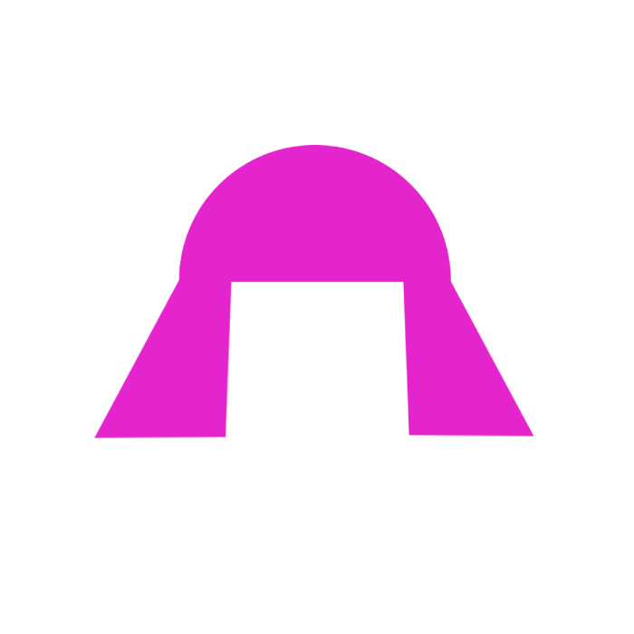

<div align="center">



<h1>amy</h1>

<p><strong>Leave it running.</strong><br>
<em><strong>A</strong>utomate <strong>MY</strong> work</em></p>

<p>
  <a href="LICENSE"></a>
  <a href="https://github.com/nicolasmelo1/amy/actions/workflows/software-factory.yml"></a>
<!-- amy:generated readme-node-badge -->


<!-- amy:end readme-node-badge -->
  
  
</p>

<p>
  <a href="#install"><strong>Install</strong></a> ·
  <a href="docs/start/quickstart.md">Quickstart</a> ·
  <a href="docs/">Documentation</a> ·
  <a href="docs/build/write-a-workflow.md">Write a workflow</a> ·
  <a href="docs/build/write-a-plugin.md">Write a plugin</a>
</p>

</div>

---

**Leave it running, and it does the long part of your work while you are
somewhere else — built the way *you* work, not the way somebody else does.**

## Install

```sh
npm install -g @amykit/cli
amy init
amy doctor
amy discover && amy tick
```

One install per machine. `amy init` writes the config and installs only the
packages that configuration names; `doctor` checks them before a ticket moves.
Run `tick` until you trust it, then `amy start --every 60` leaves the loop
running in the background.

→ [Quickstart](docs/start/quickstart.md) · [Installation](docs/start/installation.md) · [Configuration](docs/start/configuration.md)

## What it is

Writing code is not the long part of a ticket. Reading it, clarifying it,
running checks, opening the pull request, answering review, and handing it on
are the work that waits on people. amy is a small machine that keeps that work
moving one step at a time.

The process is yours: a workflow is a small directory that says what happens
next and how each step runs. Plugins connect the tracker, code host, agent,
state, notifications and the tools that are already in your environment.

→ [Overview](docs/start/overview.md) · [Workflows and profiles](docs/start/workflows-and-profiles.md) · [Plugins and the registry](docs/concepts/plugins.md)

## The one idea

```ts
plan(record, observation, policy): Plan
```

The decision is pure. It returns `act`, `advance`, `wait` or `settled`; a worker
performs the effect afterwards. The decision and the world stay separate, so a
workflow is testable before it touches a tracker, repository or agent.

→ [Workflows](docs/concepts/workflows.md) · [The engine](docs/concepts/the-engine.md) · [Actions](docs/concepts/actions.md) · [Ports](docs/concepts/ports.md)

## Commands

`--workflow <name>` chooses the profile to drive. The full reference carries
arguments, options and defaults.

<!-- amy:generated readme-commands -->

| Command | What it does |
| :-- | :-- |
| `amy add` | Add a workflow or a plugin: install it, mount it, and check the machine boots |
| `amy after-daemon` | Internal: update after a started daemon has exited |
| `amy brief` | The current statement of a feature, as the workflow keeps it |
| `amy btw` | Something to do, said in passing. Goes on the queue, never becomes a ticket |
| `amy budget` | What the agents have spent, and how close that is to the ceiling |
| `amy daemon` | The loop itself, in the foreground. `amy start` runs this for you |
| `amy discover` | Put every piece of work the workflow can find onto the queue |
| `amy doctor` | Check everything the machine depends on before it touches a ticket |
| `amy init` | Write the config and roster templates, and install what they need |
| `amy models` | What each model is believed to cost |
| `amy note` | Write a piece of friction down, and put it on the queue |
| `amy pause` | Pull the handbrake: end work in flight and start nothing new |
| `amy plugin` | What is mounted, and what is not |
| `amy poke` | Look at one piece of work now, rather than when it was next due |
| `amy queue` | Inspect and tidy the queue |
| `amy remove` | Remove a workflow or a plugin, refusing what the machine would not survive |
| `amy resume` | Release the handbrake |
| `amy roster` | Who is reviewing today |
| `amy run` | Keep advancing until nothing is due |
| `amy skills` | Install amy's skills into the harnesses on this machine |
| `amy start` | Start the loop in the background, and keep it running |
| `amy status` | Show where every piece of work stands and what the queue holds |
| `amy stop` | Stop the background loop |
| `amy tick` | Advance one piece of work by one move |
| `amy update` | Move this install forward: both roots, refusing to leave the machine half-updated |
| `amy workflow` | What this install can drive, and what it keeps |
| `amy worktrees` | Inspect and tidy the isolated checkouts work runs in |

<!-- amy:end readme-commands -->

→ [CLI reference](docs/reference/cli.md)

## The gate

```sh
npm run gate
```

<!-- amy:generated readme-factory -->

This repository runs [software factory](https://github.com/nicolasmelo1/software-factory) on itself: **47 rules**, and `sf verify` proves every one fires against a deliberately broken fixture.

**18 gates** each pin a claim to a scenario that drives the built artifact from another process, with the evidence sealed by digest. Touching covered code expires its proof, because the last run proved something that no longer exists.

<!-- amy:end readme-factory -->

→ [The gate](docs/development/the-gate.md) · [Testing](docs/build/testing.md) · [How the documentation generates itself](docs/development/documentation.md)

## Contributing

[`CONTRIBUTING.md`](CONTRIBUTING.md) is the short path from clone to a green
gate. The longer reasoning lives in [the development docs](docs/development/contributing.md).

## License

MIT
