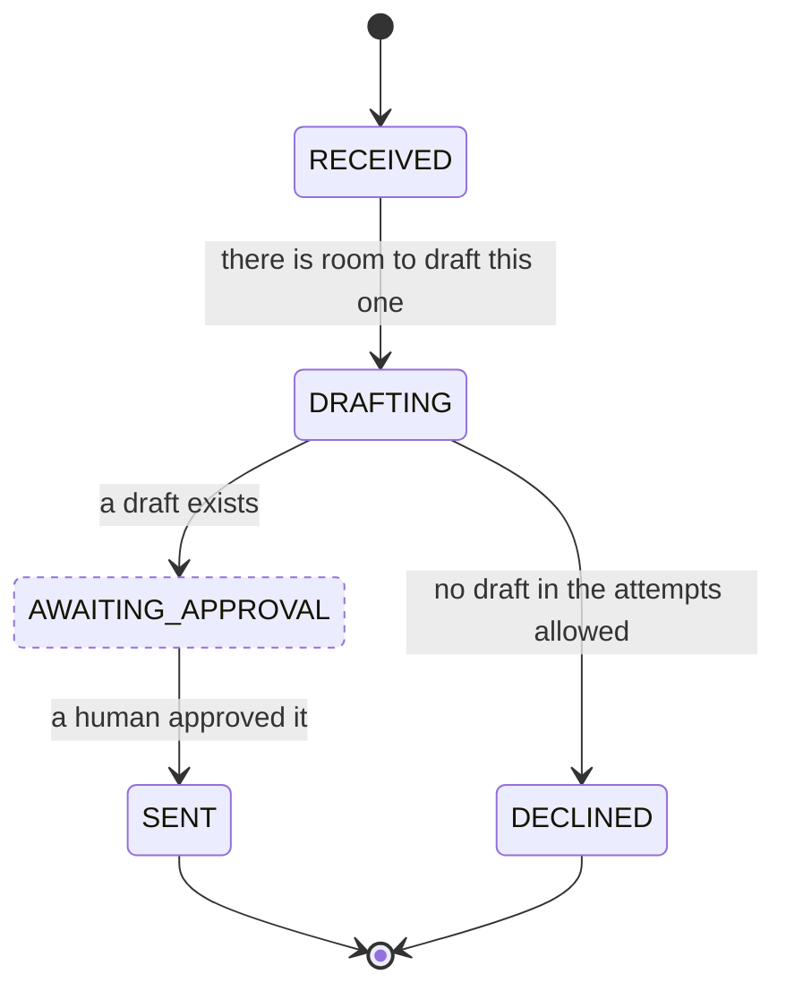

# Write a workflow

A workflow is **your process**. It is a directory on your machine, and a package
only if you decide to share it later. Nothing in amy's code names the ones it
ships, and nothing will name yours either.

This page writes one end to end. There is a complete working example in the
repository that a gate drives on every run —
[`workflow-oncall/index.ts`](https://github.com/nicolasmelo1/amy/blob/main/.software-factory/evidence/installed-plugins/workflow-oncall/index.ts)
— installed onto a machine with no checkout on it, to prove exactly this.

`/amy-workflow` will interrogate you into a design a question at a time. This
page is what it writes.

## Start from one that already runs

```sh
amy workflow new review      # ~/.amy/workflows/review, and the profile naming it
amy workflow check review    # drives its lifecycle against a stub world
cd ~/.amy/workflows/review && npm install && npm test   # the machine's own suite
```

`new` writes a workflow that already moves a piece of work — its three pieces,
each in its file: `workflow.mmd`, the diagram its states are read from;
`decide.ts`, one pure decision per drawn state; `actions.ts`, what happens in
the world; and an `index.ts` holding the one `defineWorkflow` call that joins
them. A workflow with no `workflow.mmd` beside it does not mount. It is a valid
npm package from the moment it is written — it is written `private`, so sharing
it later is a scoped name, dropping that flag and `npm publish` in the same
directory, rather than a restructuring.

What it writes is TypeScript typed against `@amykit/core`. Node strips the types and runs it from that directory as it is.
<!-- amy:generated readme-node-version -->

Node 22.18 or later runs the command.

<!-- amy:end readme-node-version -->
`npm run typecheck` is `tsc` holding it to the core's contract. Node refuses TypeScript under `node_modules`, so what `npm
publish` or `amy add <path>` takes is what `npm run build` compiles into `dist/`,
and `prepack` runs that for you. Everything below is the
same seven things with the files split — what that directory
looks like once the process is real enough to be worth the structure. Read it as
what to change, not as a file to start from empty.

## Before you write anything: answer five questions

A workflow that is hard to write is almost always one where these were not
settled first.

1. **What is one piece of work?** A ticket, a page, a customer, a week. It needs
   a stable id, because that id is the record's file name.
2. **What are its states?** Name them as *where it has got to*, not as *what to
   do next*. `PR_OPEN`, not `OPEN_THE_PR`.
3. **Which states wait on somebody else?** Those back off instead of spinning.
   Getting this wrong is the difference between a machine and a busy loop.
4. **Which states are terminal?** Including the ones that are terminal because
   the answer is *no*. `DECLINED` is a finished piece of work, not a failed one.
5. **What does it need to look at before deciding?** That is the observation,
   and everything in it must be gatherable without deciding anything.

## 1. The states



The diagram is the only place the states are written: the initial one is the
`[*]` arrow, the terminal ones point at `[*]`, and `class … waiting` marks where
the machine has nothing to do until somebody else moves. A union of the names
types your decisions; it is never read when the workflow mounts.

```ts
// src/state.ts
export type ReviewState = "RECEIVED" | "DRAFTING" | "AWAITING_APPROVAL" | "SENT" | "DECLINED";
```

Write beside each state, in a `note`, *what is true when work is in it*. Six
months later that note is the specification.

## 2. The record

```ts
// src/record.ts
import type { WorkRecord } from "@amykit/core";

export interface ReviewRecord extends WorkRecord {
  state: ReviewState;
  customer: string;
  draft?: string;
  lastAttempt?: { ok: boolean; output: string; at: string };
}

/** How many times work has been looked at in one state. */
export function attemptsIn(record: ReviewRecord, state: ReviewState): number {
  return record.attempts[state] ?? 0;
}
```

The core owns `id`, `state`, `updatedAt`, `attempts` and `history`. The
declaration's `record(workId)` callback adds only fields such as `customer`;
nothing else constructs these five fields. Everything else is yours, and your
`remember` is what folds it.

## 3. The typed effects

```ts
// src/effects.ts
import { planning } from "@amykit/core";

export type Effect =
  | { type: "draft-plan"; prompt: string }
  | { type: "announce"; text: string };

export const { act, advance, wait, settled } = planning<ReviewState, Effect>();
```

**You compose actions; you do not define them.** Check
[the catalogue](../concepts/actions.md) first — `draft-plan` and `run-errand` both
dispatch to a generic `agent.ask()`, which is almost always what a new workflow
wants. If nothing fits, register the action *and its port* from a plugin of
yours.

There is no list of the actions a workflow uses. They are the keys of
`actions` (step 6), each beside what runs it, so the host can refuse a
mount where one of them has nothing behind it — at boot, naming the action.

## 4. The observation and the policy

```ts
// src/observation.ts
export interface Observation {
  message: { id: string; body: string; customer: string };
  approved: boolean;
  inFlight: number;
}

export interface Policy {
  maxAttempts: number;
  maxInFlight: number;
  approvalBackoffMs: number;
}

export const DEFAULT_POLICY: Policy = {
  maxAttempts: 3,
  maxInFlight: 5,
  approvalBackoffMs: 15 * 60 * 1000,
};
```

The observation is **everything from outside**, gathered before deciding. The
policy is **every number**, so none of them is buried in the logic where nobody
can change it.

## 5. The decision — and it must stay pure

```ts
// src/decide.ts
import type { Plan } from "@amykit/core";

type Decision = (record: ReviewRecord, obs: Observation, policy: Policy) => Plan;

// One key per state workflow.mmd draws: a missing or extra key is refused at boot.
export const decide = {
  RECEIVED: (_record, obs, policy) => obs.inFlight >= policy.maxInFlight
    ? wait(policy.approvalBackoffMs, `${obs.inFlight} replies are already waiting`)
    : advance("DRAFTING", "there is room to draft this one"),

  DRAFTING: (record, obs, policy) => {
    if (record.lastAttempt?.ok) {
      return advance("AWAITING_APPROVAL", "a draft exists", {
        type: "announce",
        text: `A reply to ${obs.message.customer} is ready:\n\n${record.draft}`,
      });
    }

    const attempts = attemptsIn(record, "DRAFTING");
    if (attempts >= policy.maxAttempts) {
      return advance("DECLINED", `${attempts} attempt(s) produced nothing usable`, {
        type: "announce",
        text: `I could not draft a reply to ${obs.message.customer}. It is yours.`,
      });
    }

    return act(`attempt ${attempts + 1}`, {
      type: "draft-plan",
      prompt: `Draft a reply to:\n\n${obs.message.body}`,
    });
  },

  AWAITING_APPROVAL: (_record, obs, policy) => obs.approved
    ? advance("SENT", "a human approved it")
    : wait(policy.approvalBackoffMs, "nobody has approved it yet"),

  SENT: () => settled("the reply went out"),
  DECLINED: () => settled("nothing was sent, and the operator was told why"),
} satisfies Record<ReviewState, Decision>;
```

**No `await`. No `fs`. No `fetch`. No `new Date()`.** If you want one of those,
what you want is in an action.

Three habits worth copying from the shipped workflows:

- **Every `why` is a sentence a person will read in the log.** `"the ticket is
  unambiguous"`, not `"triage ok"`.
- **A ceiling is checked before the expensive thing**, not after it.
- **"The answer is no" is a terminal state, not a failure.** `DECLINED` exists so
  that giving up looks different from landing.

## 6. The actions — the half that touches the world

```ts
// src/actions.ts
import type { Moved, Plan } from "@amykit/core";

// Each piece is handed `scope`: the ports `needs` asked for, the config, the
// policy and the checkouts.
export const discover = async ({ ports }: Scope) => (await ports.inbox.unanswered()).map((m) => m.id);

export const observe = async ({ ports }: Scope, record: ReviewRecord): Promise<Observation> => ({
  message: await ports.inbox.get(record.id),
  approved: await ports.inbox.isApproved(record.id),
  inFlight: (await ports.inbox.awaitingApproval()).length,
});

// The key is the declaration, the value what runs it. A value may also be
// `{ port, method }` for a method its port marked with `acceptsAction`: the
// host calls it with the action and its context, and its answer lands in
// `outcomes` under the action's name.
export const actions = workflowActions<Effect>()({
  "draft-plan": async ({ ports }, { outcomes }, effect) => {
    const reply = await ports.agent.ask(effect.prompt, ports.workspace);
    outcomes.draft = reply.text;
  },

  // A word to the operator: a channel that fails is a `notify.failed` line, not a failed action.
  "announce": async ({ announce }, _work, effect) => announce(effect.text),
});

export function remember(
  _scope: Scope, record: ReviewRecord, outcomes: Record<string, unknown>, observation: Observation,
  _moved: Moved | null, _decision: Plan, now: Date,
): ReviewRecord {
  const next = { ...record, customer: observation.message.customer };

  if (typeof outcomes.draft === "string") {
    next.draft = outcomes.draft;
    next.lastAttempt = { ok: true, output: outcomes.draft, at: now.toISOString() };
  }

  return next;
}
```

Four things about `remember` that catch everybody:

**Do not fold the state, the attempt count or the history.** The engine already
did that through `applyPlan`. Doing it again is the defect the third workflow
found: every retry counted as two, and `maxAttempts` fired at half its
configured value.

**The observation is passed in for a reason.** Not everything a record learns
comes from an action. `approved` arrives as an observation, and a fold that
could not see one would leave the record waiting on it forever.

**`outcomes` is a bag you own at both ends.** Your handlers fill it and your
`remember` reads it. The engine only carries it between the two.

**`record` has already moved.** Its `state` is where the work is going. Where
it came from is `moved.from` — `moved` is `null` when the plan did not advance.
A resume point written as `if (plan.to === "ESCALATED" && record.state !==
"ESCALATED")` is never written, because `record.state` is already `ESCALATED`
on every move into it; `moved.from` is the state the escalation interrupted.

## 7. Wire it up as a plugin

```ts
// src/plugin.ts
import { defineWorkflow, optional, port } from "@amykit/core";
import { actions, discover, observe, remember } from "./actions.js";
import { decide } from "./decide.js";

export const configSchema: ConfigSchema = {
  policy: {
    type: "record",
    description: "maxAttempts, maxInFlight and approvalBackoffMs. Anything left out keeps its default",
    default: {},
  },
};

export const plugin = defineWorkflow({
  name: "review",
  pluginName: "@acme/workflow-review",
  configSchema,
  policy: DEFAULT_POLICY,
  needs: {
    inbox: port<Inbox>(),
    agent: port<Harness>(),
    conversation: optional<Conversation>(),
  },
  record: (workId) => ({ customer: workId }),
  decide,
  discover,
  observe,
  actions,
  remember,
});
```

The declaration takes its states from the `workflow.mmd` the host finds beside
it, and registers the workflow and its runtime under `review`. Its runtime is
deferred until every plugin has registered, built once per mount, and handed
typed ports. An absent required port is a boot refusal naming `review` and the
port; the optional conversation arrives as `undefined`. The `policy` argument is
the declared defaults with configured values overlaid, after unknown keys have
been refused. A declaration still passing `states`, a single `plan` or a
`runtime` factory is refused at boot, naming where each moved.

## 8. The walkthrough test — the only real proof

Every workflow gets one. It is the test that finds the bugs, and it only exists
because the decisions are pure.

```ts
// The workflow as amy mounts it: its states read from workflow.mmd beside it.
const review = withDiagramBeside(plugin, import.meta.url);

it("walks a message from received to sent", () => {
  let record = review.newRecord("MSG-1", at(0));
  const seen: string[] = [record.state];

  for (let look = 0; look < 20; look += 1) {
    const decision = review.workflow.plan(record, world(record), DEFAULT_POLICY);
    if (decision.kind === "settled") break;

    record = applyPlan(record, decision, at(look));
    record = fold(record, decision);            // what `remember` would have folded
    if (record.state !== seen.at(-1)) seen.push(record.state);
  }

  expect(seen).toEqual(["RECEIVED", "DRAFTING", "AWAITING_APPROVAL", "SENT"]);
});
```

Assert three things, not one:

1. **The states, in order.** The lifecycle is what you meant.
2. **One look makes at most one move.** A look that advances twice is a bug that
   hides every intermediate state from the log.
3. **It settles rather than spinning.** Bound the loop and fail if it runs out.
   An unbounded lifecycle is a machine that never stops costing money.

Then one test per branch that is not the happy path: the ceiling, every retry
exhaustion, and every path to a `DECLINED`-shaped state. Those are where the
bugs live, and every one of them runs in microseconds with no I/O.

`amy workflow check <name>` is the first of those three as a command, plus a
fourth: it drives the workflow against a stub world and refuses a waiting state
that moved before the world did, an action the plan emits that no handler
answers, a state the walkthrough never reaches, and a run that does not settle
in a terminal state. It needs no test runner, which is the point — it is what to
run while editing. The tests above are what survives the editing.

The scaffold's `index.test.ts` is the rest: `conforms` from
`@amykit/workflow-testkit`, which mounts the workflow the way amy does and walks
its runtime through the worlds you give it and fails a state nothing leaves, an action with nothing behind it, a
wait counted as a try, a decision made by an empty `every`, and a giving-up
state with no honest way out — none of which is about your domain, and all of
which reached a real board before there was a test for them. Add a world each
time the workflow grows a state; see [Testing](testing.md#the-conformance-suite).

The scaffold's `.software-factory/` is the static half: `sf check` in the
workflow's directory refuses `checkout -B`, a fold that reads `.state` off the
record it is handed, and a `.every(` that does not say what an empty collection
means, at the first commit rather than the first world that replays it. Why
each exists is in the rule; see
[the guardrails ship with the workflow](../design/the-guardrails-ship-with-the-workflow.md).

## 9. Drive it

```yaml
# ~/.amy/config.yaml
workflows:
  review:
    workflow: review                      # the directory; a scoped name once published
    plugins:
      - review                            # the workflow mounts like any other plugin
      - "@amykit/plugin-file-queue"
      - "@amykit/plugin-file-store"
      - "@amykit/plugin-serial-engine"
      - "@amykit/plugin-agent-relay"
      - "@amykit/plugin-claude"
      - "@amykit/plugin-notify-fanout"
      - "@amykit/plugin-notify-inbox"
```

```sh
amy --workflow review discover
amy --workflow review tick
amy --workflow review status
```

Nothing is installed in between: the profile names the directory, and the loader
resolves it before it looks in a registry. Publishing later changes one line —
the profile names `@acme/workflow-review`, and that package is what gets
installed on the next machine.

It runs on the same engine, against the same budget, in the same log, with the
same handbrake as everything else. Its records and queue live under
`~/.amy/review/`, so it never touches another profile's state.

## The mistakes worth naming

| Mistake | What it costs |
| :-- | :-- |
| `await` inside a decision | The walkthrough test needs I/O, so nobody writes it, so the lifecycle is never proven |
| Folding state or attempts in `remember` | Every retry counts twice; ceilings fire at half their value |
| No waiting state | A busy loop that burns quota politely |
| No terminal "no" state | Giving up looks exactly like landing |
| A ceiling checked after the agent call | A report, not a brake |
| Defining an action instead of composing one | Your workflow drags a domain nobody else can reuse |
| A `why` written for a machine | A log nobody can read at 3am |

## Worth reading next

- [Workflows](../concepts/workflows.md) — the contract, in detail.
- [Actions](../concepts/actions.md) — what to compose before inventing.
- [Testing](testing.md) — the walkthrough test, and proving the artifact.
- [Publishing](publishing.md) — getting it into the catalogue.
