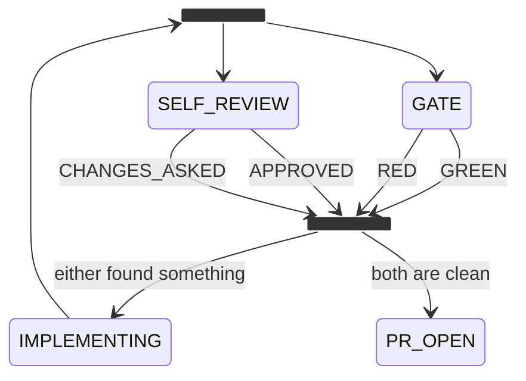

# Workflows

A workflow is **the order in which actions happen, plus how each one runs**. It
is three pieces, always in the same place, and keeping the decision apart from
the world is the single most important thing about this codebase.

```text
   workflow.mmd          decide                         actions
   ────────────          ──────                         ───────
   where work can go     where this work goes next      what happens in the world
   a Mermaid diagram     pure, synchronous, per state   async, through the ports
                         (record, observation, policy)  discover, observe, remember
                              → Plan
```

## The diagram

The states, where work starts, where it waits and where it ends are read from
the `workflow.mmd` beside the workflow's entry, or at its package root, and from
nowhere else. A workflow declares no list of states. One whose host finds no
diagram beside it is refused when it mounts, naming the workflow and the file it
needs; so is a declaration that still passes `states`, `waiting` or `terminal`.
See [a workflow is a Mermaid diagram](../design/a-workflow-is-a-mermaid-diagram.md)
for the subset amy reads.

## The decision half

`decide` has one key per state the diagram draws, each a pure function of the
record, a snapshot of the outside world and the policy. A state the diagram
draws with no key, or a key for a state it does not draw, is refused at boot by
name. `before` answers ahead of every state's decision and `after` sees every
decision; the three compose into the one pure function the engine calls:

```ts
plan(record, observation, policy): Plan
```

It returns one of four things:

<!-- amy:generated plan-kinds -->

| Kind | Fields | What it means |
| :-- | :-- | :-- |
| `act` | `kind: "act"`<br>`effects: Effect[]`<br>`why: string`<br>`attempt: boolean` | Do the work, stay in this state, and look again straight away. The next look sees whatever the actions recorded, which is how a pure decision function drives work that takes minutes or hours. |
| `advance` | `kind: "advance"`<br>`to: State`<br>`effects: Effect[]`<br>`why: string` |  |
| `wait` | `kind: "wait"`<br>`retryAfterMs: number`<br>`why: string`<br>`effects: Effect[]` | Nothing to do until the outside world moves. May still carry actions, so a workflow can say why it is stuck without leaving the state. |
| `settled` | `kind: "settled"`<br>`why: string` | Terminal, do not queue anything else. |

<!-- amy:end plan-kinds -->

It touches no tracker, no code host, no repository and no agent. If you find
yourself wanting to `await` something inside a decision, the thing you want
belongs in an action.

**What purity buys.** A sixteen-state lifecycle, including the paths where a
review requests changes and where the agent disagrees with a reviewer, is walked
end to end in a test in milliseconds with no I/O. That test is the one that
finds the bugs, and it only exists because the function is pure.

## The world half

The rest of the declaration says what the engine cannot know. Each piece
receives the ports `needs` asked for, the config, the policy and the checkouts,
and the core builds them into the workflow's runtime after every plugin has
registered:

| Member | What it answers |
| :-- | :-- |
| `discover` | What work exists that is not on the queue yet |
| `observe(scope, record)` | What the outside world looks like, for this record, right now |
| `actions` | Every action this workflow can emit, each beside what runs it |
| `remember(scope, record, outcomes, observation, moved, decision, now)` | How what happened folds back into the record |
| `policy` | The numbers the decisions are given — attempt ceilings, backoffs, how many open reviews one person may carry |

`remember` is the subtle one. The engine has already folded the state, the
attempt count and the history through `applyPlan`; it cannot fold the rest,
because it does not know what a triage result or a gate result is. The
**observation** is passed to it too, because not everything a record learns
comes from an action — an answer somebody left on a ticket arrives as an
observation, and a fold that could not see one would leave the record waiting
on it forever. A workflow that keeps nothing beyond the core's fields leaves it
out.

The **record** `remember` is handed has already moved: its `state` is where the
work is going, not where the look started. Where it came from is `moved.from`,
and `moved` is `null` when the plan did not advance. A fold that remembers where
an escalation interrupted the work reads `moved`, never `record.state` — a guard
written against `record.state` on a move into `ESCALATED` sees `ESCALATED` every
time, and excludes every escalation there is.

**`actions`** is one declaration per action: the key is the name the plan
emits, the value is what runs it.

```ts
actions: {
  "hand-off-to-qa": async (scope, work, effect) => { /* scope.ports, scope.announce */ },
  "merge": { port: "forge", method: "merge" },
}
```

A value is a handler the workflow wrote, or a port and a method the host wires:
it calls the method with the action and its context, and puts what comes back in
`outcomes` under the action's name. Only a method its port marked with
`acceptsAction` can be wired that way — a method written for its own arguments,
`check(repo, workId)` say, would be handed an action where it expects a
repository, so the mount refuses it and a handler calls it instead. Because the name and the implementation are
the same entry, an action cannot be declared without something behind it, nor
planned without being declared. The mount refuses at boot, by name, a key whose
value is neither, a port nothing mounted, or a method the port does not have.
The engine refuses a plan that carries a name the map does not, before any of
that plan's actions run.

A handler receives its ports from the host, bound to the work. Every reply from
`agent` writes an `agent.run` line against the work and its state, which is
what the budget adds up, so an action never writes one itself. The agent's own
failures are not swallowed, and still fail the action.

Beside the ports, an action gets `announce(text)`: a word to the operator that
is only worth saying. A channel that fails becomes a `notify.failed` line
rather than a failed action, because a channel somebody misconfigured must
never cost a move. `ports.notifier` stays strict, for a message the work
depends on: a write handed to the operator that nobody heard has to fail the
action, so the look is tried again rather than recorded as said.

## One declaration joins the pieces

```ts
export const plugin = defineWorkflow({
  name: "errand",
  configSchema,
  policy: DEFAULT_POLICY,
  needs: { tasks: port<Tasks>(), notifier: port<Notifier>() },
  record: () => ({}),
  decide,                       // one key per state workflow.mmd draws
  discover: ({ ports }) => ports.tasks.pending(),
  observe: ({ ports }, work) => ports.tasks.read(work.id),
  actions: {
    announce: (scope, _work, effect) => scope.announce(effect.text),
  },
});
```

`defineWorkflow` registers the pure workflow and contributes its runtime under
the same name. The runtime is built after every plugin has registered, so a
required port nobody mounted is refused at boot and an `optional<T>()` port is
handed to it as `T | undefined`.

The diagram's `[*]` arrow names the initial state. The core constructs each new
record with `id`, `state`, `updatedAt`, `attempts` and `history`;
`record(workId)` returns only the workflow's own fields. Policy defaults are
merged with the configured `policy` mapping at boot, and an override whose key
is not in the defaults is refused by name.

The keys of **`actions`** declare the workflow's *reach*, which the host checks
at boot: an action with nothing behind it refuses the mount by name.

Only this form mounts. A declaration that still passes a single `plan()` or a
`runtime()` factory is refused at boot, naming each and where it moved: `plan`
onto `decide`, `runtime` onto `discover`, `observe`, `actions` and `remember`.
A plugin that registers a workflow by hand, with `registry.workflow(...)`, is
the core's own contract for its unit tests; amy never mounts one from an
install or from `~/.amy/workflows`, and refuses it naming the plugin.

## Effects are described, never performed

The machine emits an effect; what the workflow's `actions` declared for it performs it. Nothing about
that is a formality — it is what keeps "what was decided" and "what the world
did" separable, and therefore separately testable.

A workflow declares its own typed view of the actions it composes:

```ts
export type Effect =
  | { type: "triage" }
  | { type: "ask-question"; questions: string[] }
  | { type: "implement"; retryContext?: string }
  | { type: "run-gate" }
  | { type: "announce"; text: string };
```

The core owns the *names* and how each one is dispatched. The *payload* each one
carries in this workflow lives here, which is what lets the decision function
stay type-checked while the core stays ignorant.

## Attempts, and why `advance` does not count

`applyPlan` counts an attempt for `act` and `wait`, and not for `advance`.

Work done *inside* a state is counted, so every retry loop is bounded. Actions
carried by an `advance` are one-shot transition actions and are not retried, so
counting them would make a lifecycle that moves forward look like one that is
stuck.

This is also where the second-workflow defect showed up: every runtime was
folding the plan into the record twice, so every retry counted as two, and the
`maxAttempts` ceiling fired at half its configured value.

## Lanes: work that runs side by side

A record is in one state at a time, and that stays true. Work that can run side
by side is drawn as a `<<fork>>`, and every line out of it is a lane:



Every lane is a call, so every lane is a record of its own, and each takes its
input from its own binding. The caller waits in the fork while they run and
moves to the join when every one has ended; `record.lanes` then holds where
each ended and what it returned, keyed by lane, for the join's `decide` to
read. A lane that escalates leaves its siblings running, and the fork says
which lane needs the person. Each lane's end has an edge into the join, named
for it, as every call's end does.

There is no setting for how many lanes there are: draw four and there are
four. The serial engine moves them one look at a time, in turn;
`@amykit/plugin-concurrent-engine` moves every lane that has a move at once.
A lane takes a lease on the branch it writes before it checks it out, so two
lanes never write one branch, and a binding's `revision` lends a lane a tree
detached at the caller's commit, read-only. See
[a workflow runs on lanes](../design/a-workflow-runs-on-lanes.md).

## The shipped workflows

<!-- amy:generated workflow-states -->

### `@amykit/workflow-errand`

Something said in passing becomes work: capture it, do it, say what happened.

|  |  |
| :-- | :-- |
| Profile name | `errand` |
| Source | `packages/workflow-errand` |
| Starts in | `QUEUED` |
| Terminal | `DONE`, `DECLINED` |
| Waits in | `QUEUED` |
| Actions it emits | `announce`, `open-pull-request`, `run-errand` |

| # | State | Kind |
| :-- | :-- | :-- |
| 1 | `QUEUED` | initial, waiting |
| 2 | `WORKING` | working |
| 3 | `PR_OPEN` | working |
| 4 | `DONE` | terminal |
| 5 | `DECLINED` | terminal |

### `@amykit/workflow-note-to-plan`

The note-to-plan workflow: friction becomes a plan in the repository it is about.

|  |  |
| :-- | :-- |
| Profile name | `note-to-plan` |
| Source | `packages/workflow-note-to-plan` |
| Starts in | `NOTED` |
| Terminal | `DONE`, `DECLINED` |
| Waits in | `NOTED` |
| Actions it emits | `announce`, `check-plan`, `draft-plan`, `open-pull-request` |

| # | State | Kind |
| :-- | :-- | :-- |
| 1 | `NOTED` | initial, waiting |
| 2 | `DRAFTED` | working |
| 3 | `CHECKED` | working |
| 4 | `PR_OPEN` | working |
| 5 | `DONE` | terminal |
| 6 | `DECLINED` | terminal |

### `@amykit/workflow-pull-request`

A workflow other workflows call: open a pull request for a branch, through whichever code host is mounted.

|  |  |
| :-- | :-- |
| Profile name | `pull-request` |
| Source | `packages/workflow-pull-request` |
| Starts in | `OPENING` |
| Terminal | `OPENED`, `REFUSED` |
| Waits in | _nowhere_ |
| Actions it emits | `open-pull-request` |

| # | State | Kind |
| :-- | :-- | :-- |
| 1 | `OPENING` | initial |
| 2 | `OPENED` | terminal |
| 3 | `REFUSED` | terminal |

### `@amykit/workflow-ticket-to-qa`

The ticket-to-QA workflow: its states, its typed port contracts, and a pure plan().

|  |  |
| :-- | :-- |
| Profile name | `ticket-to-qa` |
| Source | `packages/workflow-ticket-to-qa` |
| Starts in | `DISCOVERED` |
| Terminal | `DONE` |
| Waits in | `CLARIFYING`, `COPILOT_WAIT`, `HUMAN_REVIEW`, `ESCALATED` |
| Actions it emits | `address-threads`, `announce`, `ask-question`, `assign-reviewer`, `discuss`, `escalate`, `hand-off-to-qa`, `implement`, `open-pull-request`, `request-rereview`, `resolve-review-thread`, `run-gate`, `self-review`, `triage` |

| # | State | Kind |
| :-- | :-- | :-- |
| 1 | `DISCOVERED` | initial |
| 2 | `CLARIFYING` | waiting |
| 3 | `READY` | working |
| 4 | `IMPLEMENTING` | working |
| 5 | `checks` | working |
| 6 | `GATE` | working |
| 7 | `SELF_REVIEW` | working |
| 8 | `verdict` | working |
| 9 | `PR_OPEN` | working |
| 10 | `COPILOT_WAIT` | waiting |
| 11 | `COPILOT_FIX` | working |
| 12 | `REVIEWER_ASSIGNED` | working |
| 13 | `HUMAN_REVIEW` | waiting |
| 14 | `HUMAN_FIX` | working |
| 15 | `ESCALATED` | waiting |
| 16 | `RE_REVIEW` | working |
| 17 | `APPROVED` | working |
| 18 | `QA_HANDOFF` | working |
| 19 | `DONE` | terminal |

<!-- amy:end workflow-states -->

## Writing one

A workflow of yours is a directory under `~/.amy/workflows`, and it is a package
only if you decide to share it later. `amy workflow new <name>` writes its three
pieces — `workflow.mmd`, `decide.ts` and `actions.ts`, joined by the one call in
`index.ts` — and it already moves a piece of work;
`amy workflow check <name>` drives it against a stub world and reports what it
got wrong.

[Write a workflow](../build/write-a-workflow.md) is the full walkthrough, from
what the scaffold wrote to a walkthrough test. `/amy-workflow` designs one by
interrogating you a question at a time.
