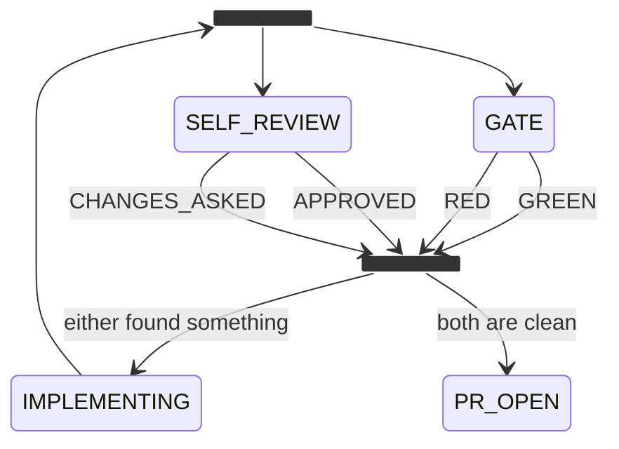

# Workflows

A workflow is **the order in which actions happen, plus how each one runs**.
It has a diagram, a decision per state and the actions, always in the same
place, and one `defineWorkflow` call joins them. Keeping the decision apart from
the world is the most important thing about this codebase.

```text
   workflow.mmd          decide                         actions
   ────────────          ──────                         ───────
   where work can go     where this work goes next      what happens in the world
   a Mermaid diagram     pure, synchronous, per state   async, through the ports
```

## The diagram

The states, where work starts, where it waits and where it ends are read from
the `workflow.mmd` beside the workflow's entry, or at its package root, and from
nowhere else. A workflow declares no list of states. One with no diagram beside
it is refused when it mounts, naming the workflow and the file it needs; so is a
declaration that still passes `states`, `waiting` or `terminal`.

`[*] --> S` names the initial state and `S --> [*]` a terminal one. Classes say
what an arrow cannot: `waiting`, `attention`, `anywhere`, `returns` and `call`.
Why, and the exact subset amy reads: [a workflow is a Mermaid
diagram](../design/a-workflow-is-a-mermaid-diagram.md).

## One declaration

```ts
import { act, advance, defineWorkflow, port, settled, wait, type Harness, type WorkRecord } from "@amykit/core";

/** The workflow's own port: the core has never heard of a task. */
interface Tasks {
  all(): string[];
  read(id: string): string | undefined;
}

type Run = { type: "run-errand"; prompt: string };
interface ErrandRecord extends WorkRecord {
  answer: string;
}

export const plugin = defineWorkflow({
  name: "errand",
  configSchema: {},
  policy: { maxAttempts: 2 },
  needs: { tasks: port<Tasks>(), agent: port<Harness>() },
  record: () => ({ answer: "" }),
  discover: async ({ ports }) => ports.tasks.all(),
  observe: async ({ ports }, record: ErrandRecord) => ({ task: ports.tasks.read(record.id) }),
  decide: {
    QUEUED: (_record, world) =>
      world.task === undefined ? wait(60_000, "the task is not written yet") : advance("WORKING", "a task is there"),
    WORKING: (record: ErrandRecord, world, policy) =>
      record.answer !== "" ? advance("DONE", "the agent answered")
        : (record.attempts.WORKING ?? 0) >= policy.maxAttempts ? advance("DONE", "out of attempts")
          : act<Run>("ask the agent", { type: "run-errand", prompt: world.task ?? "" }),
    DONE: () => settled("the errand is done"),
  },
  actions: {
    "run-errand": async ({ ports, checkouts }, _work, effect) => {
      await ports.agent.ask(String(effect.prompt), checkouts.git.pathFor("errand", "app"));
    },
  },
  remember: (_scope, record: ErrandRecord, outcomes) => ({ ...record, answer: String(outcomes["run-errand"] ?? record.answer) }),
});
```

`defineWorkflow` registers the workflow and contributes its runtime under the
same name, so the pair cannot be half mounted. The runtime is built once every
plugin has registered ([a mount builds once](../design/a-mount-builds-once.md)),
so plugin order does not matter.

- **`needs`** is the port list, typed. A required port nothing mounted is
  refused at boot naming the workflow and the port; an `optional<T>()` one
  arrives as `T | undefined`.
- **`policy`** is the defaults. The config's `policy` mapping goes over them at
  boot, and a key the defaults do not have is refused by name.
- **`record`** returns only the workflow's own fields. The core writes `id`,
  `state`, `updatedAt`, `attempts`, `looks` and `history`.
- **`configSchema`** types `config` in every piece
  ([a config is typed by its schema](../design/a-config-is-typed-by-its-schema.md)).
- Every piece gets the ports, the config, the policy and `checkouts`, the
  repository checkouts the host lends ([Ports](ports.md#checkouts)).

Only this form mounts. A declaration that still passes a single `plan()` or a
`runtime()` factory is refused at boot, naming each and where it moved. A
plugin that registers a workflow by hand with `registry.workflow(...)` is the
core's own contract for its unit tests; amy refuses one from an install or from
`~/.amy/workflows`, naming the plugin. Why it is one call: [a workflow is one
declaration](../design/a-workflow-is-one-declaration.md) and [the note on decide and
actions](../design/a-workflow-is-three-pieces.md).

## The decision half

`decide` has one key per state the diagram draws, except a call state and a
fork, whose callee and lanes decide for them. Each is a pure function of the
record, a snapshot of the world and the policy. A missing key, or one for a
state the diagram does not draw, is refused at boot by name. `notWritten()`
stands in for a decision not written yet: it mounts, and settles the record
saying so.

`before` answers ahead of every state's decision and `after` sees every
decision, for the rules that hold in every state. Together they compose into
the one pure function the engine calls. It returns one of these:

<!-- amy:generated plan-kinds -->

| Kind | Fields | What it means |
| :-- | :-- | :-- |
| `act` | `kind: "act"`<br>`effects: Effect[]`<br>`why: string`<br>`attempt: boolean` | Do the work, stay in this state, and look again straight away. The next look sees whatever the actions recorded, which is how a pure decision function drives work that takes minutes or hours. |
| `advance` | `kind: "advance"`<br>`to: State`<br>`effects: Effect[]`<br>`why: string` |  |
| `wait` | `kind: "wait"`<br>`retryAfterMs: number`<br>`why: string`<br>`effects: Effect[]` | Nothing to do until the outside world moves. May still carry actions, so a workflow can say why it is stuck without leaving the state. |
| `settled` | `kind: "settled"`<br>`why: string` | Terminal, do not queue anything else. |

<!-- amy:end plan-kinds -->

A decision touches no tracker, no code host, no repository and no agent. If you
want to `await` something inside one, it belongs in an action. That is what
lets the whole ticket-to-qa lifecycle, review rounds included, be walked in a
test in milliseconds with no I/O.

**Looks and attempts.** Every `act` and `wait` adds a look in its state. Only an
`act` adds an attempt, and not one marked `act(why, { attempt: false }, ...)` or
whose action answered `notATry`. An `advance` adds neither: its actions are
one-shot. So a ceiling on attempts counts real tries, and waiting for a checkout
never spends one ([waiting is not trying](../design/waiting-is-not-trying.md)).

## The world half

- **`discover`** returns work that is not on the queue yet.
- **`observe(scope, record)`** says what the world looks like for this record
  now.
- **`actions`** is one entry per action the decisions may emit: the key is the
  name, the value is a handler or `{ port, method }`. An action with nothing
  behind it, or a plan naming one the map does not have, is refused. See
  [Actions](actions.md).
- **`remember(scope, record, outcomes, observation, moved, decision, now)`**
  folds what happened back into the record. The record has already moved: where
  it came from is `moved.from`, never `record.state`. It is given the
  observation too, because an answer somebody left on a ticket arrives as one. A
  workflow that keeps nothing beyond the core's fields leaves it out.

A handler gets its ports bound to the work. Every reply from `agent` writes an
`agent.run` line, which is what the budget adds up. `announce(text)` says a word
to the operator, and a channel that fails becomes a `notify.failed` line rather
than a failed action. `ports.notifier` stays strict, for a message the work
depends on.

`extend(registry, ctx)` is the rest of a plugin, for a workflow that also mounts
a queue, a port of its own or a harness.

## Calls and lanes

A state marked `call` runs another workflow as a child record, bound in `calls`
with `call(workflow, { input, config, ports, output })`. Its edges out are named
for the callee's terminal states. A workflow declares what a caller passes in
`input` and what it returns at each end in `output`. Calls nest, and a cycle is
refused at boot. See [a workflow calls another](../design/a-workflow-calls-another.md).

A called record's id is the call's, `SHOP-1/WORK#1`. What the tracker, the
code host or a person is told names the unit it is for, `unitOf(record)`. A
called phase's own actions reach the mount through its `catalogue`, and the
testkit walks every world called as a phase too. See [a shipped workflow runs
as a phase](../design/a-shipped-workflow-runs-as-a-phase.md).

Work that runs side by side is drawn as a `<<fork>>`, and every line out of it
is a lane:



Every lane is a call, so a record stays in one state. The caller waits in the
fork and moves to the join when every lane has ended; `record.lanes` holds
where each ended and what it returned, for the join's `decide`. Draw more lines
for more lanes. The serial engine moves them in turn and
`@amykit/plugin-concurrent-engine` moves them at once. A lane leases the branch
it writes, so no branch has a second writer. See [a workflow runs on
lanes](../design/a-workflow-runs-on-lanes.md).

## The shipped workflows

<!-- amy:generated workflow-states -->

### `@amykit/plugin-prove`

Proves a phase against the real system: one workflow walks the scenario each brief settled, through the operations the mounted plugins offer.

|  |  |
| :-- | :-- |
| Profile name | `prove` |
| Source | `plugins/prove` |
| Starts in | `READING` |
| Terminal | `refused`, `PROVEN` |
| Waits in | `READING`, `LEASING`, `ASKING` |
| Actions it emits | `ask`, `finish`, `give-up`, `lease`, `prepare`, `renew`, `run-step` |

| # | State | Kind |
| :-- | :-- | :-- |
| 1 | `READING` | initial, waiting |
| 2 | `LEASING` | waiting |
| 3 | `PREPARING` | working |
| 4 | `refused` | terminal |
| 5 | `RUNNING` | working |
| 6 | `ASKING` | waiting |
| 7 | `PROVEN` | terminal |

### `@amykit/workflow-errand`

Something said in passing becomes work: capture it, do it, say what happened.

|  |  |
| :-- | :-- |
| Profile name | `errand` |
| Source | `examples/workflow-errand` |
| Starts in | `QUEUED` |
| Terminal | `DONE`, `DECLINED` |
| Waits in | `QUEUED` |
| Actions it emits | `announce`, `open-pull-request`, `run-errand` |

| # | State | Kind |
| :-- | :-- | :-- |
| 1 | `QUEUED` | initial, waiting |
| 2 | `WORKING` | working |
| 3 | `PR_OPEN` | working |
| 4 | `DONE` | terminal |
| 5 | `DECLINED` | terminal |

### `@amykit/workflow-feature-grooming`

Feature grooming against read-only base-branch source snapshots.

|  |  |
| :-- | :-- |
| Profile name | `feature-grooming` |
| Source | `examples/workflow-feature-grooming` |
| Starts in | `GROOMING` |
| Terminal | `BRIEFED` |
| Waits in | `GROOMING` |
| Actions it emits |  |

| # | State | Kind |
| :-- | :-- | :-- |
| 1 | `GROOMING` | initial, waiting |
| 2 | `BRIEFED` | terminal |

### `@amykit/workflow-note-to-plan`

The note-to-plan workflow: friction becomes a plan in the repository it is about.

|  |  |
| :-- | :-- |
| Profile name | `note-to-plan` |
| Source | `examples/workflow-note-to-plan` |
| Starts in | `NOTED` |
| Terminal | `DONE`, `DECLINED` |
| Waits in | `NOTED` |
| Actions it emits | `announce`, `check-plan`, `draft-plan`, `open-pull-request` |

| # | State | Kind |
| :-- | :-- | :-- |
| 1 | `NOTED` | initial, waiting |
| 2 | `DRAFTED` | working |
| 3 | `CHECKED` | working |
| 4 | `PR_OPEN` | working |
| 5 | `DONE` | terminal |
| 6 | `DECLINED` | terminal |

### `@amykit/workflow-pull-request`

A workflow other workflows call: open a pull request for a branch, through whichever code host is mounted.

|  |  |
| :-- | :-- |
| Profile name | `pull-request` |
| Source | `examples/workflow-pull-request` |
| Starts in | `OPENING` |
| Terminal | `OPENED`, `REFUSED` |
| Waits in | _nowhere_ |
| Actions it emits | `open-pull-request` |

| # | State | Kind |
| :-- | :-- | :-- |
| 1 | `OPENING` | initial |
| 2 | `OPENED` | terminal |
| 3 | `REFUSED` | terminal |

### `@amykit/workflow-setup`

Onboarding as an amy workflow: amy setup walks a fresh machine through harness, workflow and channels, one ask at a time.

|  |  |
| :-- | :-- |
| Profile name | `setup` |
| Source | `packages/workflow-setup` |
| Starts in | `DETECTING` |
| Terminal | `DONE`, `STOPPED` |
| Waits in | `HARNESS`, `WORKFLOW`, `CHANNELS`, `CONFIGURING` |
| Actions it emits | `ask-setting`, `check`, `install`, `pending`, `ping`, `post`, `read-config`, `setup`, `write-ladder`, `write-settings`, `write-setup-profile`, `write-workflow` |

| # | State | Kind |
| :-- | :-- | :-- |
| 1 | `DETECTING` | initial |
| 2 | `HARNESS` | waiting |
| 3 | `PLUGIN_INSTALLED` | working |
| 4 | `PINGED` | working |
| 5 | `WORKFLOW` | waiting |
| 6 | `CHANNELS` | waiting |
| 7 | `CONFIGURING` | waiting |
| 8 | `CHECKED` | working |
| 9 | `DONE` | terminal |
| 10 | `STOPPED` | terminal |

### `@amykit/workflow-ticket-to-qa`

The ticket-to-QA workflow: its states, its typed port contracts, and a pure plan().

|  |  |
| :-- | :-- |
| Profile name | `ticket-to-qa` |
| Source | `examples/workflow-ticket-to-qa` |
| Starts in | `DISCOVERED` |
| Terminal | `DONE` |
| Waits in | `CLARIFYING`, `COPILOT_WAIT`, `HUMAN_REVIEW`, `ESCALATED` |
| Actions it emits | `address-threads`, `announce`, `ask-question`, `assign-reviewer`, `discuss`, `escalate`, `hand-off-to-qa`, `implement`, `open-pull-request`, `request-rereview`, `resolve-review-thread`, `run-gate`, `self-review`, `triage` |

| # | State | Kind |
| :-- | :-- | :-- |
| 1 | `DISCOVERED` | initial |
| 2 | `CLARIFYING` | waiting |
| 3 | `READY` | working |
| 4 | `IMPLEMENTING` | working |
| 5 | `checks` | working |
| 6 | `GATE` | working |
| 7 | `SELF_REVIEW` | working |
| 8 | `verdict` | working |
| 9 | `PR_OPEN` | working |
| 10 | `COPILOT_WAIT` | waiting |
| 11 | `COPILOT_FIX` | working |
| 12 | `REVIEWER_ASSIGNED` | working |
| 13 | `HUMAN_REVIEW` | waiting |
| 14 | `HUMAN_FIX` | working |
| 15 | `ESCALATED` | waiting |
| 16 | `RE_REVIEW` | working |
| 17 | `APPROVED` | working |
| 18 | `QA_HANDOFF` | working |
| 19 | `DONE` | terminal |

<!-- amy:end workflow-states -->

## Writing one

A workflow of yours is a directory under `~/.amy/workflows`, and a package only
if you decide to share it. `amy workflow new <name>` writes `workflow.mmd`,
`decide.ts` and `actions.ts`, joined by the call in `index.ts`, and it moves a
piece of work before you edit it. `amy workflow check <name>` drives it against
a stub world and reports what it got wrong.

[Write a workflow](../guides/write-a-workflow.md) is the walkthrough, and
`/amy-workflow` designs one by asking you a question at a time.
