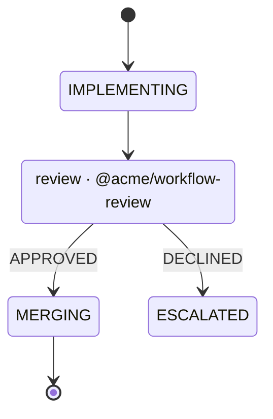

# A workflow calls another

A workflow should compose the way code does. A small workflow is a function: it
takes input and configuration, does its work, and returns at one of its ends
with an output. A bigger workflow calls it at the point where that work
belongs, the same way a function calls a library, and the callee can call
others in turn, as deep as the work needs. Installing somebody else's workflow
then means using it inside your own, instead of adopting their whole process.

Today composition happens in TypeScript, out of sight.
[A private workflow composes the shipped one](a-private-workflow-composes-the-shipped-one.md)
made it possible for a private workflow to import `ticket-to-qa`'s `plan` and
runtime, and that private workflow shrank to its policy, prompts and gate
commands. But nothing in either diagram shows where one workflow ends and the
other begins. Nothing checks the seam either: the importer reaches into the
other workflow's states and record fields as if they were its own.

The repetition is already in this repository. All three shipped workflows open
a pull request and wait on it:

- `note-to-plan` and the errand both go `PR_OPEN → DONE`;
- `ticket-to-qa` runs its whole review loop from `PR_OPEN` to `MERGING`.

That is one small workflow written three times.

## What changes

**A state can be a call.** In the diagram it is an ordinary state, marked with
the class `call`. Its label may name what it calls, for whoever reads the file
on GitHub or in Obsidian:



The edges out of a call state are named for the callee's terminal states. They
are the return values the caller handles. Mermaid has no `import` or `include`,
and its state syntax needs none for this: the label is prose, the class is
what amy reads, and the binding to a package is in code. The subset that
[a workflow is a Mermaid diagram](a-workflow-is-a-mermaid-diagram.md) reads
gains `call` beside `waiting`, `attention`, `anywhere` and `returns`.

**A workflow declares its signature.** `defineWorkflow`
([a workflow is three pieces](a-workflow-is-three-pieces.md)) gains three
optional members:

- `input`: what a caller must pass, as a schema, the way `configSchema` types a
  plugin's settings ([a config is typed by its schema](a-config-is-typed-by-its-schema.md)).
  The record starts with it, and `decide` reads it typed.
- `output`: what it returns, keyed by terminal state. `APPROVED` may return
  `{ mergedAt }`, and `DECLINED` `{ reason }`. A workflow with no `output`
  returns nothing at any end.
- `configSchema`: the callee's own settings. They are set per call site, so the
  same review workflow can allow three rounds in one caller and one round in
  another.

**A caller binds the call in one place.** Beside `decide` and `actions`:

```ts
calls: {
  REVIEW: call(review, {
    input: (work) => ({ repo: work.repo, pullRequest: work.pullRequest }),
    config: { maxRounds: 3 },
    ports: { agent: "agent-strong" },
    output: {
      APPROVED: (work, out) => ({ ...work, mergedAt: out.mergedAt }),
      DECLINED: (work, out) => ({ ...work, declinedFor: out.reason }),
    },
  }),
},
```

Every member is optional, because a call is often a one-off that takes
nothing and returns nothing. The smallest call is `REVIEW: call(review)`.

- `input` maps the caller's record to the callee's input, typed both ways. It
  is required only when the callee declares an `input`, and refused when the
  callee declares none.
- `config` is the callee's settings for this call, validated against its schema
  at boot.
- `ports` binds each of the callee's `needs` to a port the root has mounted,
  by name, defaulting to the port with the same name. Every dependency of the
  whole tree is therefore configured once, at the root, in `config.yaml`. A
  need nothing satisfies is refused at boot with the full call path, for example
  `oncall → REVIEW → FIX: needs code-host`.
- `output` folds a return value into the caller's record. It needs an entry only
  for the terminal states whose `output` the callee declares, and only when the
  caller keeps that value. An entry for a state the callee does not have, or
  for one that returns nothing, is refused by name. A caller may also ignore a
  return value it has no use for.
- `effects` are what the caller does on the edge out, the way any advance may
  carry effects: `effects: { OPENED: (work, out) => [{ type: "announce", … }] }`.
  Each runs as one of the caller's own actions. The errand needs it: it said
  where its pull request was on the move into `DONE`, and a call returns with
  nothing said unless the caller says it here. An entry for an end the callee
  does not have is refused by name.

What is never optional is the edge. Every terminal state of the callee needs
an edge out of the call state in the caller's diagram, named after it,
because that edge is where the caller goes when the callee ends there. A
terminal state with no edge is refused at boot by name. A call state needs a
`calls` entry and no `decide` key. The call is its decision.

**Calls nest without limit, and never in a circle.** A callee may call others.
At mount, amy builds the graph of calls from every workflow in the tree and
refuses a cycle, naming it: `review → fix → review`. Depth has no limit. A
cycle is the only thing that cannot terminate by construction, so it is the
only thing refused.

**A call is a child record, and it costs nothing while it runs.**

- **Entering the state.** Each time the caller enters a call state, a new
  callee record is created, and kept inside the caller's record under
  `calls`, so a store, a queue and an engine that never heard of calls carry
  it unchanged. Its id is the call site plus an invocation number:
  `TBO-1/REVIEW#1`, and below it `TBO-1/REVIEW#1/FIX#1`. A caller may go
  through the same call state again (`REVIEW → FIX → REVIEW`), and that is not
  a cycle in the call graph. That second entry is `TBO-1/REVIEW#2`, a new
  record, and `#1` keeps its history and output as they were. The caller's
  record holds the id of the call it is waiting on. A restart therefore resumes
  that same record. Only a new transition into the call state starts a new
  one. The child starts at its initial state with its input.
- **Only the deepest active record is looked at.** A caller in a call state
  waits, but it waits on an event, not a timer. The engine looks at it again
  only when its child reaches an end. So a tree five calls deep is not five
  records polling: it is one record working and four that cost nothing. Each
  look of the child reaches the engine as a look its caller took without
  trying, so the caller's state, attempts and ceilings stay where they were.
- **Returning.** When the child reaches a terminal state, the next look is
  the caller's: it is observed again, the child's output is folded in with
  that call's `output` function, the caller's own fold runs, and the caller
  takes the edge named for that terminal state, carrying the call's `effects`.
- **Each record keeps its own history.** Each child has its own `attempts`,
  `looks`, evidence and kept runs, so nothing a callee counts can push a caller
  over its ceiling.
- **The machine's own limits are the root's.** The budget and the
  evidence policy a workflow opts into (*no retry is free*) are the engine's,
  and the engine holds one queue item per root, so they are read off the
  root: a callee's own `progress` is not applied inside a call. An action a
  callee declares as a port and a method stays that binding in the composed
  runtime whenever nothing makes it ambiguous, so the budget still sees an
  action that spends the agent; one whose port the call rebinds runs through
  the call.

**What a callee does is bounded by its caller.** A callee's write claims must
fit inside its caller's claims, so installing a workflow cannot hand it a
tracker or code-host write the person never granted. A callee whose claims
exceed its caller's is refused at boot, naming the write; and the callee is
handed the root's own ports, which refuse an unclaimed write at the call
besides. A child that escalates makes its root show attention: `amy status`
puts `attention` against the root, draws where the work is from the root down
(`REVIEW › FIX › ESCALATED`), and shows the move that stopped the child beside
it, so the person sees where in the tree it stopped without opening the copy.
`callStanding` in the core is what answers it, and what the menu bar and the
window ask once they exist. The evidence an escalation brings
(*an escalation brings its evidence*) is that row's to add, on the child's
record, and it is shown with the root the same way.

**A callee is a package, or a copy you own.** A call names its callee the way
code names a module: a package specifier or a path, imported in the caller's
code. A callee exports itself drawn, `withDiagramBeside(plugin, import.meta.url)`,
because no host reads the directory a callee was installed into.

- As a package it is a dependency of the package that calls it, pinned like
  any other and updated with it: `@amykit/workflow-note-to-plan` depends on
  `@amykit/workflow-pull-request`, and installing one installs the other.
- `amy workflow add @acme/workflow-review --into oncall` copies the whole
  workflow into `~/.amy/workflows/oncall/workflows/review/` instead: its
  diagram, its source tree with every file its entry imports by a relative
  path, and the assets it ships. Its package dependencies are added to the
  caller's manifest and installed, and a dependency that cannot be resolved
  refuses the copy before anything is written. That is how
  shadcn/ui hands out components: the source becomes yours to read and change,
  and nothing updates it behind you. The copy is still a workflow, and it is
  called the same way.

Either way, the binding names it once, and the call graph is checked the same
way.

**The tree is drawn from the files.** `amy status` lists a caller with the
record's path through its callees, and `amy workflow export --expand`
inlines each callee as a Mermaid composite state, `state REVIEW { … }`, with
`--work <id>` marking the record at every depth. That is valid Mermaid and
renders on GitHub, and it is generated for reading only. The source subset
keeps refusing composite states, because a source file holds one workflow and
a call holds the rest. `amy workflow check` walks a caller through its calls,
counting a move inside a call as the caller's progress.

## The first callee

`@amykit/workflow-pull-request` is the step all three shipped workflows
repeat: opening a pull request. It ends as soon as the pull request exists,
because `note-to-plan` and the errand finish there today: a pull request open
with no review is their `DONE`
(`packages/workflow-note-to-plan/tests/machine.test.ts`). Following the
review to a merge is a different workflow, which can call this one.
It needs a `code-host` and names no host: it reads and writes only through the
`CodeHost` port, so the same callee opens a pull request on GitHub today and a
merge request on GitLab or Bitbucket once a plugin implements that port. The
caller's `config.yaml` picks the adapter. A method the port only offers
optionally is declared as a capability the callee needs —
`port<CodeHost>({ requires: ["findPullRequestMentioning"] })`, so a pull
request whose branch was renamed is found by the id its title names rather
than opened twice — and a host without it is refused at boot by name. It takes
a repository, a branch, a title, a body and a base as input, finds or opens
the pull request, and returns `OPENED` with its number and URL, or `REFUSED`
with the host's reason. Its one setting is `draft`, set per call site: the
errand opens drafts and `note-to-plan` does not.

`REFUSED` is the host's answer, not its outage. The port gained
`CodeHostRefusal`, which an adapter throws when the host answers that it will
not open one — GitHub's 422 — and the callee returns `REFUSED` at once with
those words. Any other failure fails the look and the engine retries it as it
always did, which is what keeps a code host that is not answering a tick that
gives up and leaves a note behind, as `note-to-plan`'s scenario has always
asserted.

`note-to-plan` and the errand call it in place of their own `PR_OPEN`, so each
finishes when it did before: `PR_OPEN --> DONE: OPENED`, and a refusal hands
the work back with `PR_OPEN --> DECLINED: REFUSED`, saying the host's reason
on the way out. What the call is passed is worked out on the move into
`PR_OPEN`, where the note or the task is in hand, and kept on the record.

`ticket-to-qa` still opens its own. Its `PR_OPEN` is entered from five review
states as well as the first time, so moving it onto the call is the same
change as extracting its review loop as a second callee that calls this one —
the natural next step, and not in this plan.

## Acceptance criteria

- [x] A call state with no `calls` entry, a callee terminal state with no edge
      out of the call state, an `output` entry for a state that returns
      nothing or does not exist, an `input` for a callee that takes none, and
      a callee need no mounted port satisfies are each refused at boot, by name
      and call path
      (proof: test:packages/core/tests/calls.test.ts)
- [x] `call(callee)` with no input, config, ports or output mounts and runs a
      callee that declares none of them
      (proof: test:packages/core/tests/calls.test.ts)
- [x] `@amykit/workflow-pull-request` runs unchanged against a second
      `CodeHost` adapter that is not GitHub, and refuses one missing a
      capability it declares
      (proof: test:packages/workflow-pull-request/tests/hosts.test.ts)
- [x] A caller that enters the same call state twice gets two callee records,
      `#1` and `#2`, each with its own history and output, and a restart
      during `#2` resumes `#2` rather than starting `#3`
      (proof: test:packages/workflow-testkit/tests/calls.test.ts)
- [x] `amy workflow add --into` copies a multi-file callee whose relative
      imports and package dependencies still resolve, and refuses one whose
      dependency cannot (proof: test:packages/cli/tests/workflow-add.test.ts)
- [x] A cycle of calls at any depth is refused at mount, naming every workflow
      on it (proof: test:packages/core/tests/calls.test.ts)
- [x] A call three deep runs to the end: the caller's record waits without
      being looked at, takes the edge named for the callee's terminal state,
      and holds the output the callee returned
      (proof: test:packages/workflow-testkit/tests/calls.test.ts)
- [x] The same callee called from two sites with two configs behaves
      according to each config
      (proof: test:packages/workflow-testkit/tests/calls.test.ts)
- [x] A callee whose write claims exceed its caller's is refused at boot,
      naming the write (proof: test:packages/core/tests/calls.test.ts)
- [x] A callee that escalates shows attention at its root, and the move that
      stopped it is shown with the root
      (proof: assertion:calls.a_callee_escalates_to_its_root)
- [x] `amy workflow add --into` copies a callee into the caller's directory,
      and the copy is called and drawn like the package
      (proof: assertion:mine.a_copied_callee_is_called)
- [x] While a call runs through the installed executable, only the deepest
      record is observed
      (proof: assertion:calls.only_the_deepest_record_is_looked_at)
- [x] `amy workflow export --expand` prints a composite diagram Pele parses
      (proof: test:packages/cli/tests/workflow-export.test.ts)
- [x] In the `note-to-plan` scenario, the pull request is opened by a call:
      the installed executable creates the callee's child record, and the
      note's record takes the `OPENED` edge with the number the stand-in `gh`
      gave. The same holds in the errand's scenario, from *the errand is proven
      end to end* (proof: assertion:plan.the_pull_request_is_opened_by_a_call)
      (proof: assertion:errand.the_pull_request_is_opened_by_a_call)
- [x] `note-to-plan` and the errand call `@amykit/workflow-pull-request`
      instead of their own `PR_OPEN`, and their scenarios are unchanged
      (proof: assertion:plan.a_refused_draft_goes_back_to_the_agent)
      (proof: assertion:errand.the_lifecycle_walks_in_order)

**Exit condition:** in their end-to-end scenarios, run through the installed
executable, `note-to-plan` and the errand open their pull requests by calling
one shipped workflow and finish when they did before. Their gates require it,
and watch `packages/workflow-pull-request/`; the `a-workflow-calls-another`
gate cites this note. The callee is configured per
caller and bound to ports in one `config.yaml`. A workflow three calls deep runs to its end with
only the deepest record ever looked at. A cycle is refused at mount. A callee
copied into somebody's own workflow directory is called the same way as the
package it came from.

## What the scenarios had to learn

"Unchanged" held for every assertion either scenario made before: the same
lifecycle, the same pull requests, the same bodies, the same ceiling. Two
things were added, because the diagrams gained an arrow. Each run now carries
one more piece of work, in a repository whose stand-in `gh` answers 422, so
`PR_OPEN --> DECLINED: REFUSED` is walked like every other arrow its diagram
draws, and the counts that named five records and seven arrows name six and
eight. The errand's stand-in `gh` now also returns the link a pull request
has, which it never did: the errand had been announcing `undefined` where the
link belonged, and the new assertion is what found it.

## The files

| | |
| --- | --- |
| `packages/core/src/calls.ts` | `call`, the child record, the composed workflow and runtime, `callStanding` |
| `packages/core/src/expand.ts` | the composite diagram `--expand` prints |
| `packages/workflow-pull-request/` | the first callee |
| `packages/cli/src/workflow-add.ts` | `amy workflow add --into` |
| `.software-factory/evidence/a-workflow-calls-another/drive.ts` | the scenario: a workflow of one's own calling a copied callee, until it escalates |

