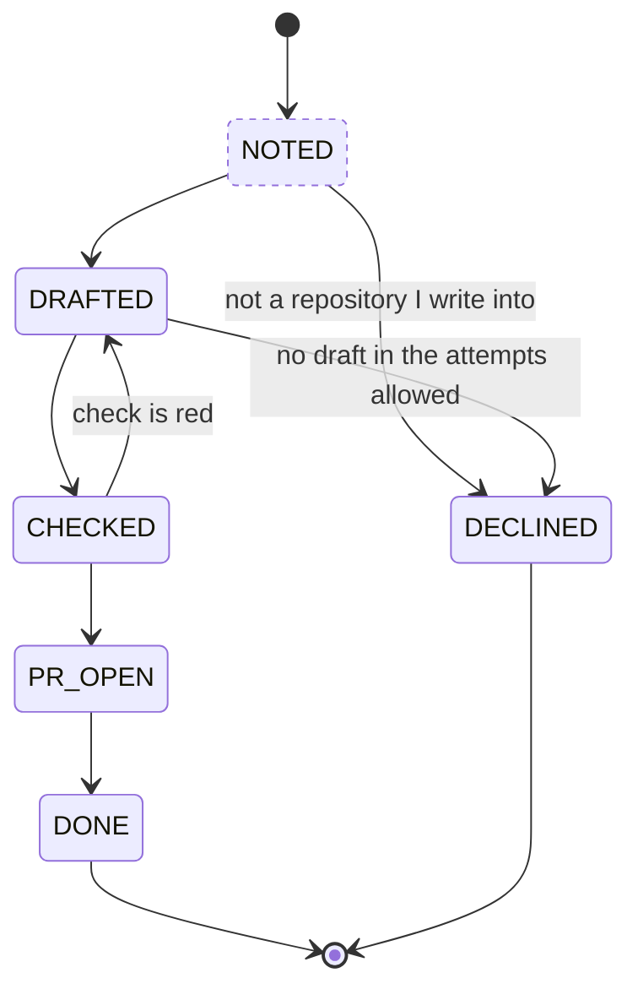

# A workflow is a Mermaid diagram

A workflow somebody designs should be theirs: a file they can read without amy,
put in a note, paste into a pull request and take to another tool. There is no
standard for workflows at the level Markdown is for text. There is one for
their *shape*: a Mermaid `stateDiagram-v2` block renders on GitHub in any
Markdown file, issue or comment, and in Obsidian, with nothing installed.

amy already draws its workflows that way, by hand. `/amy-show-me` writes a
`stateDiagram-v2` block from what it reads each time it is asked, and nothing
checks it against the code. The shape itself is written in four other places
that agree only by care:

- the states, as a `const` array in each workflow's `state.ts`;
- `waitingStates`, `initialState` and `terminalStates` on the `Workflow`;
- the `StateMachine` primitive's `states` and `transitions`, built per view;
- the transitions themselves, which are declared nowhere: they exist only as
  the `advance` calls inside `plan()`. The text renderer draws an edge only
  when the tree declares one — "the order of `states` is not a path" — so
  every strip drawn today is a line of names.

amy is a framework for workflows the way Rails is one for web applications:
a few pieces, always in the same place, and everything else derived from them
by convention. The diagram is the first of the three pieces, the one that says
where work can go. Deciding where it goes next, and doing it, are the other two
and stay in code, in the same `defineWorkflow` that
[a workflow is one declaration](a-workflow-is-one-declaration.md) gives every
workflow.

## What changes

**The shape of a workflow is a file beside it, and nothing else.** A workflow
is a directory. One under `~/.amy/workflows`, or a package root, holds
`workflow.mmd` beside its entry, and the host finds it there the way it already
finds `index.ts`. Nothing names the file and nothing is generated from it. The
host reads it when the workflow mounts and derives the states, the initial
state, the terminal states and the waiting states. The workflow declares none
of them. Declaring them as well as drawing them is refused at boot, because it
is the same fact said twice. A workflow written by hand without a diagram keeps
declaring its fields as it does today. So `defineWorkflow`'s `states`,
`waiting` and `terminal` become optional, and are required only when no
diagram lies beside the workflow.

amy reads a subset of `stateDiagram-v2`, and every line of it is ordinary
Mermaid:

- `[*] --> S`, exactly once, names the initial state; `S --> [*]` names a
  terminal one.
- `A --> B` and `A --> B: label` are the transitions. A label is prose for a
  reader. amy does not interpret it.
- Classes say what an edge cannot say, and amy reads four of them:
  - `waiting`: nothing moves until the world does;
  - `attention`: it waits on the person whose work it is (*amy lives in the
    menu bar*);
  - `anywhere`: any state that is not terminal may move to it;
  - `returns`: it leaves to the state the record came from.

  The last two exist because real workflows have them. The private workflow
  amy runs at work escalates from every state its ceilings guard and resumes
  where it stopped. It hands a pull request merged by hand to QA from whichever state it was in.
  Drawing those as edges would be some twenty arrows each, and the diagram
  would stop being readable. Mermaid has no wildcard and no history state, so
  amy uses a class. A `note` beside the state says it in words for whoever
  reads the file elsewhere.
- Any other class, every `classDef` style, `%%` comments, `note` blocks and
  `direction` are left for whoever renders the file.
- Composite states, `<<choice>>`, `<<fork>>`, `<<join>>` and concurrent
  regions are refused by name, with the line. A record is in one flat state,
  and a construct amy cannot map to that would be drawn as something the
  machine does not do.

**The reader is amy's own, and the core stays without dependencies.** The
subset is six line forms. A parser for them is smaller than the dependency
that would replace it, and `@amykit/core` has none today. Mermaid has no
grammar published as a specification; its parser is the reference, and the
`mermaid` package expects a browser. So the oracle is
[Pele](https://pele.run), Obsidian's Mermaid renderer (`obsidianmd/pele`,
MIT). It is synchronous, runs in Node with no DOM and no dependencies, and its
parsers are tested against Mermaid's own parser specs and by differential
fuzzing. It is a development dependency of the core's tests: every diagram
amy's reader accepts must also parse under Pele, as a `state` diagram, with
the same states, transitions and classes. A construct both accept but amy
refuses says why.

**The diagram is the shape. The decisions are still code.** What decides a
transition is still pure TypeScript: reading the observation, the policy's
numbers, the first-look announcement, the text of a message. Putting it in
labels would make the file Mermaid in syntax only: a language no other tool
reads, which is the problem this row exists to avoid. Asking an agent to
interpret a label at each look would give up the purity that lets the
walkthrough run with no network.

**A transition is a contract, checked where it is cheap.** The host already
holds the diagram, so it checks a workflow's code against it on two
occasions:

- **At boot.** A state the diagram draws with no decision, or a decision for a
  state it does not draw, is refused by name. This applies once
  *a workflow is three pieces* gives decisions a key per state. A decision
  may be the core's `notWritten()` stub. A stub mounts, and on a look it
  settles the record with "the decision for <state> is not written yet"
  rather than guessing a move. `amy workflow check` lists every stub, so the
  scaffold an import writes mounts on the first boot and still says what is
  left to write.
- **On every walk.** The testkit and `amy workflow check` record every
  transition. An `advance` to a state the diagram does not connect fails,
  naming both ends. Leaving to an `anywhere` state, or out of a `returns`
  state to where the record came from, is connected. An edge no walk took is
  listed as *drawn, not walked*. For the three shipped workflows that is a
  failure, because their walkthroughs walk every edge. For a workflow that is
  still being written, it is the to-do list.

At runtime, an undrawn transition is applied and written to the event log as
`workflow.undrawn_transition`. Refusing it would leave somebody's work stuck
because of a drawing mistake.

**Export and import are the file.**

- `amy workflow export <name>` prints it.
- With `--work <id>`, it adds a `class` line marking the record's current
  state. The result is still valid Mermaid, so pasting it into a GitHub
  comment shows where the work is.
- `amy workflow new <name> --from <file.mmd>` copies somebody's diagram in
  beside a scaffold whose every decision is a `notWritten()` stub. It mounts
  as it is, and the first `amy workflow check` lists each stub and every edge
  as drawn, not walked.

Each of these commands is a shortcut. Writing the two files by hand gives the
same workflow.

**Every view of a workflow is drawn from its diagram, when it has one.** The
`StateMachine` primitive gains an optional `diagram` prop, the Mermaid text,
beside the `states` and `transitions` the server reads out of it. A workflow
written by hand without a diagram still has its `states`, and its views carry
those with no `diagram` and no edges. Every renderer draws them as the text
renderer does today, and the window's Workflows canvas says that the workflow
has no diagram, instead of drawing one it does not have. A renderer that draws
in a webview — the desktop app, and a web or phone client later — hands the
text to Pele and gets an SVG. A renderer that draws characters — the text one
and the terminal — draws the parsed states and edges, as the text renderer
already does. That is two drawings of one file. Neither renderer parses
Mermaid on its own, and nothing that draws characters carries a graph
layout. This changes the closed vocabulary, so the conformance world takes a
diagram, and the golden is regenerated and locked in this row.

**The skills and the docs read the file.** `/amy-show-me` reads
`workflow.mmd` instead of drawing from what it inferred. `/amy-workflow` ends
each round of its interrogation by editing the diagram, then writes the
decisions the diagram asks for. *Workflows* and *Write a workflow* describe the
file when *the docs describe the contract that exists* rewrites them.

The three shipped workflows and the errand get their diagram, and lose their
state lists. Each gate that drives one of them adds its `workflow.mmd` to its
activation, so a changed diagram makes its proof stale the way changed code
does. The installed `workflow-oncall` fixture keeps its hand-written
fields, so the gate that drives it keeps proving that a workflow without a
diagram still mounts.

## What this is not

- Not a layout. Mermaid lays the graph out, and no position is stored.
- Not generated code. Nothing is written from the diagram into the workflow.
  The diagram is read where it lies, every time the workflow mounts.
- Not the window's editor. *amy has a window* gives the Workflows canvas the
  diagram, drawn and editable as text. This row gives that editor the file to
  edit and the check to run on save.

## What was delivered

The reader is `readDiagram` in `@amykit/core` (`packages/core/src/diagram.ts`):
the six line forms, the four classes, everything else left to the renderer
or refused by name and line. `connects` answers whether the diagram joins two
states, through an arrow, an `anywhere` state or a `returns` state going back
to where the record came from. `markState` adds the two lines `export --work`
prints. Pele is a development dependency of the core's and the CLI's tests,
and nothing else.

`defineWorkflow`'s `states`, `waiting` and `terminal` are optional.
`withDiagramBeside(plugin, entry)` is how a host hands a workflow its
diagram: the CLI's loader, `amy workflow check`, `amy workflow export` and the
docs generator all call it with the entry they imported, and it finds
`workflow.mmd` beside a local workflow's entry or at a package's root. A
declaration that declares its states as well is refused at boot naming the
fields, a diagram amy cannot read is refused with its file and line, and a
raw `Plugin` with a diagram beside it is refused, because it already says its
states in code. A workflow with neither says so when it is mounted or read.
`attention` states wait, as far as the engine is concerned, so a workflow's
`waitingStates` is both classes in the order the diagram draws them.

`Workflow` gains an optional `diagram`. The serial engine writes
`workflow.undrawn_transition` (`packages/core/events.json`) for a move it does
not connect and makes the move anyway. The testkit's seventh property, *every
move is one the diagram draws*, fails an undrawn move naming both ends, and
with `everyEdge: true` an arrow no world walks. `amy workflow check` holds a
walk to the diagram the same way and lists stubs and unwalked arrows as the
to-do list, not as failures. `notWritten()` is the core's stub, and
`notWrittenIn(plan)` reads one back.

The three shipped workflows each have a `workflow.mmd`, shipped in their
package, and no list of states, waits or ends at runtime. Each keeps a
TypeScript union of its state names, because that is what types its
decisions — `PLANNERS: Record<TicketState, Planner>` is still what proves no
state was forgotten until *a workflow is three pieces* moves that check to the
diagram; it is never read when the workflow mounts, and a name in it the
diagram does not draw is a move the walkthrough refuses. Their exported
`errand`, `noteToPlan`, `ticketToQa` and `newRecord` are gone: they were the
unmounted declaration, which has no states until a host reads its diagram. A
consumer binds it with `withDiagramBeside(plugin, entry)`.

Walking every arrow found one the shipped `ticket-to-qa` could not rest on:
a reviewer who asks for changes, every thread judged and nothing pushed, sent
the work from `HUMAN_REVIEW` to `RE_REVIEW` and back on every look, asking
again each time, because the review that sent it back was still on the head.
`HUMAN_REVIEW` now waits, after asking again, for a review submitted since it
asked.

The StateMachine primitive takes an optional `diagram`, the conformance
world's work profile is drawn from one and its personal profile is not, and
the golden is relocked. The window's Workflows canvas, which says a workflow
has no diagram, arrives with [amy has a window](../../plans/amy-has-a-window.md);
there is no window yet to say it in. The boot check of one decision per drawn
state arrives with [a workflow is three pieces](a-workflow-is-three-pieces.md),
as this plan said it would; until then `amy workflow check` finds every stub
by asking each drawn state.

The errand has no gate, so its diagram is held by its conformance suite
alone until [the errand is proven end to end](../../plans/the-errand-is-proven-end-to-end.md).
The note-to-plan, ticket-to-qa, a-private-workflow-composes and
a-question-is-not-an-answer gates add their workflow's `workflow.mmd` to
their activation.

## Acceptance criteria

- [x] The subset reads the initial, terminal, waiting, attention, `anywhere`
      and `returns` states and every transition of a diagram, and refuses each
      unsupported construct by name and line
      (proof: test:packages/core/tests/diagram.test.ts)
- [x] Every diagram the subset accepts parses under Pele as a state diagram
      with the same states, transitions and classes
      (proof: test:packages/core/tests/diagram-mermaid.test.ts)
- [x] A workflow with a `workflow.mmd` beside it mounts with the states the
      file draws and declares none, and one that declares them as well is
      refused by name
      (proof: test:packages/core/tests/mount.test.ts)
- [x] An `advance` to a state the diagram does not connect fails the walk,
      naming both ends; a move to an `anywhere` state or back out of a
      `returns` state does not; and an edge no walk took is listed
      (proof: test:packages/workflow-testkit/tests/transitions.test.ts)
- [x] Changing a shipped workflow's diagram makes the gate that drives it
      stale (proof: test:packages/cli/tests/diagram-gates.test.ts)
- [x] Each shipped workflow's walkthrough takes every edge its diagram draws
      (proof: assertion:plan.every_drawn_edge_is_walked)
- [x] `amy workflow new --from` turns a diagram into a workflow that mounts,
      whose stubs settle rather than move, and whose check lists every stub
      and every edge not walked
      (proof: assertion:mine.a_diagram_becomes_a_workflow)
- [x] `amy workflow export --work` prints a diagram Mermaid's parser accepts,
      with the record's state marked
      (proof: test:packages/cli/tests/workflow-export.test.ts)
- [x] Every `StateMachine` for a workflow with a diagram carries it, one for a
      workflow without carries its states and no diagram, and the golden is
      relocked
      (proof: assertion:frame.nothing_moved_since_it_was_approved)
- [x] A workflow with no diagram, written by hand, still mounts and is driven
      (proof: assertion:plugins.a_workflow_from_outside_this_repository_mounts)

**Exit condition:** each of the three shipped workflows is a `workflow.mmd`
that GitHub renders. Its states, waits and ends are read from that file, with
no list of them anywhere in its code, and its walkthrough takes every edge the
file draws. A diagram written in another tool becomes a workflow that mounts,
either by hand or through `amy workflow new --from`. `amy workflow export
--work` pastes into a pull request comment and shows where that work is.
