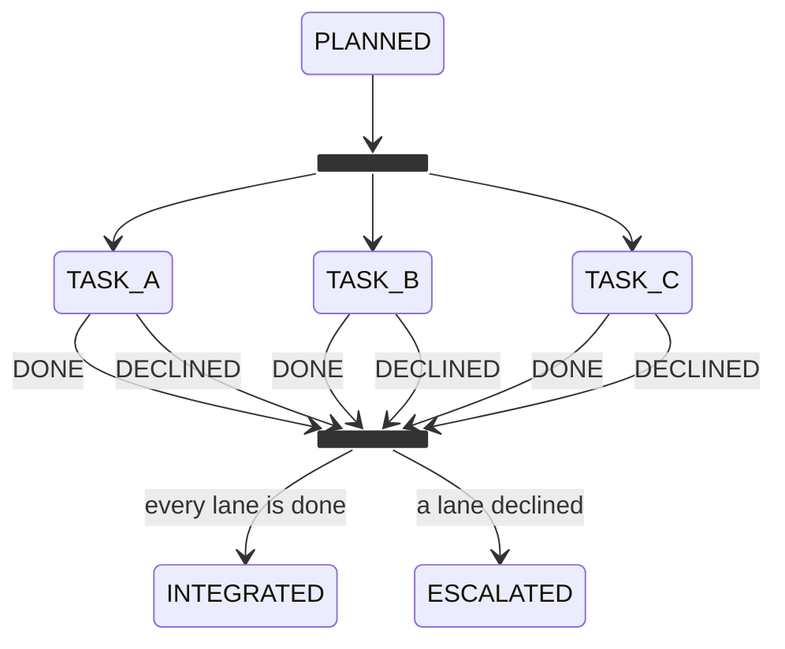
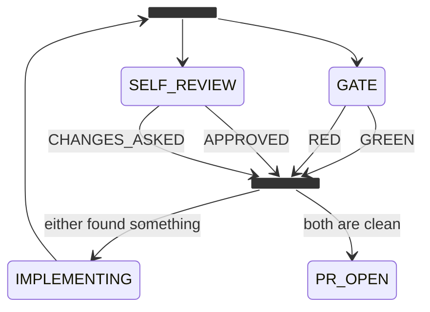

# A workflow runs on lanes

amy is synchronous, and that is worth keeping. One move per look, one look per
item, and a record is always in one state you can point at. Reading what the
machine is doing is reading a diagram with a mark on it.

But a lot of work is a factory line, not a single file. Some pieces can run
side by side and meet again after: three tasks of one feature on three
branches, three reviewers of one change, three repositories of one ticket.
Today that is one record at a time, serially, or it is written by hand in a
workflow's runtime, out of the diagram's sight.

`docs/concepts/the-engine.md` already says a concurrent engine is a plugin, as
long as it keeps the atomic claim, one move per look, and the budget check
before the call. What is missing is where a workflow says what may run in
parallel. A setting would be one more place to keep in step with the diagram.
The diagram is where it belongs.

## What changes

**A lane is a line in the diagram.** Mermaid already has the syntax:
`<<fork>>` splits one path into several, and `<<join>>` waits for all of them.
The subset (*a workflow is a Mermaid diagram*) stops refusing the two, and
gives them one meaning. Every branch of a fork is a lane, and the number of
lanes is the number of lines drawn:

There is no `lanes:` setting. To run four lanes, draw four. What a reader sees
on GitHub is what the machine runs.

**A record stays in one state. Every lane is a call.** The reader refused fork
and join because "a record is in one state at a time" (`packages/core/src/diagram.ts`).
That stays true. Every branch of a fork must be a call state
(*a workflow calls another*), and each lane is its own child record, with its
own state, history and attempts:

- **At the fork,** the caller's record waits in the fork, and every branch
  starts its callee at once.
- **Input per lane.** Each lane takes its input from its own call binding:
  `TASK_A` gets the first task, `TASK_B` the second.
- **Into the join, the call contract holds.** A lane is a call, so every
  terminal state of its callee needs an edge out of the lane, labelled with
  that state (*a workflow calls another*). In a fork, each of those edges leads
  to the join. A lane terminal with no edge into the join is refused at boot,
  as it would be anywhere else.
- **At the join,** the caller moves on only when every lane has ended. The
  join is the caller's decision point: its `decide` key reads which terminal
  state each lane ended in, with every lane's output folded in and keyed by the
  lane's state. It picks one of the join's outgoing edges. The join holds no
  record of its own. It is where the caller's record waits until it decides.
- **When a lane escalates,** its siblings carry on, and the caller waits in the
  join. The join reports which lanes are done and which one needs the person.

Within a lane, everything is as synchronous as today. Parallelism is only
between records that are already separate.

**Lanes hold what they use, and the host decides who waits.** Three lanes can
contend for the same things:

- **A checkout.** The private workflow's `waitForTheTree` exists because two
  pieces of work shared one tree. A lane's checkout comes from
  `ctx.checkouts()` (*the host lends the checkout*), one worktree per lane
  ([the worktree is the workplace](the-worktree-is-the-workplace.md)).
  Separate worktrees do not stop two lanes from writing one branch.
  `Git.prepareBranch()` checks a branch out with `--ignore-other-worktrees`,
  and which branch a lane uses is known only at run time, from its input. So
  the host keeps an atomic lease per repository and branch, taken the way the
  file queue takes a claim, before any checkout or mutation. A lane that asks
  for a branch another lane holds waits on it. That wait costs no attempt
  (*waiting is not trying*), and the lane looks again when the lease is
  released. Boot refuses only a conflict it can see without running anything:
  two call bindings whose branch is the same literal.
- **The revision a lane checks.** A lane that checks the caller's work, not
  writes its own, needs the caller's change, not the base.
  `WorktreeManager.acquire()` makes a new worktree detached at the
  repository's base (`plugins/file-worktree/src/manager.ts`). So a call binding
  may pass `revision`: the commit the caller's record holds. The host then
  lends that lane a worktree detached at that commit, read-only for the lane.
  Every lane of the fork sees the same commit, and none of them can move the
  caller's branch.
- **An agent.** Every lane's run passes the same budget check before the call,
  and a usage limit refunds the attempt (*waiting is not trying*). Three lanes
  hitting the limit wait, they do not fail.
- **A pull request.** Lanes that open pull requests on one repository open
  separate ones. Integrating them is the state after the join, drawn as such.

None of these is declared by the workflow. They follow from the ports a lane
uses, and the host serialises what two lanes would otherwise share.

**The engine moves more than one lane at once, and nothing else changes.**
The serial engine stays the default and runs lanes one move at a time, in turn.
That is correct, only slower. A concurrent engine runs one move per lane at a
time, up to the number of lanes the fork draws. It keeps the file queue's
atomic claim, one move per look, and the budget check before the call. It is a
plugin, as `docs/concepts/the-engine.md` says it should be.

**`ticket-to-qa` is the first workflow on lanes, and its scenario is the
proof.** Today it runs the gate, then the self-review, one after the other
(`CHECKED → SELF_REVIEW` in its `workflow.mmd`). One ticket showed what that
order costs. A stronger model approved the change twice, and the gate refused
it twice, on rules the reviewer never saw. The implementation was sent back
with half the findings each time. With lanes, `CHECKED` forks into a `GATE`
lane and a `SELF_REVIEW` lane, each a call. They join, and the
implementation gets both sets of findings in one round:

The `ticket-to-qa` scenario
(`.software-factory/evidence/ticket-to-qa-scenario.sh`) drives it end to end
through the installed executable, against its stand-in world. Both lanes are
bound with the implementation's commit as `revision`, and the scenario asserts
that the gate and the self-review each checked that commit and not the base. It runs once
under the serial engine and once under the concurrent one, and both runs must
reach the same record.

**The window draws lanes as lines.** The fork's lanes are drawn side by side,
each with its record's mark. A join shows how many lanes have arrived. That is
the factory floor: you see where the line backs up.

## Acceptance criteria

- [x] A diagram whose fork branches are all call states mounts, one whose
      branch is not a call is refused naming it, and a join with a branch that
      never reaches it is refused
      (proof: test:packages/core/tests/diagram.test.ts)
- [x] A fork of three lanes starts three callee records at once, each with its
      own input, and the caller leaves the join only when all three have
      ended, with every output keyed by lane
      (proof: test:packages/workflow-testkit/tests/lanes.test.ts)
- [x] A lane that escalates leaves its siblings running, and the caller waits
      in the join saying which lane needs the person
      (proof: test:packages/workflow-testkit/tests/lanes.test.ts)
- [x] Two lanes never share a worktree. Two lanes that ask for one repository
      and branch at run time take its lease in turn: the second waits without
      an attempt and goes on when the lease is released. Boot refuses only
      bindings whose branch is the same literal
      (proof: test:packages/core/tests/lanes.test.ts)
- [x] A lane bound with `revision` checks a worktree detached at that commit,
      and cannot move the caller's branch
      (proof: test:packages/core/tests/lanes.test.ts)
- [x] A lane terminal with no labelled edge into the join is refused at boot,
      and the join's `decide` reads every lane's terminal state and output
      (proof: test:packages/core/tests/diagram.test.ts)
- [x] Under the serial engine, the lanes reach the same end state, in turn,
      as under the concurrent one, in the `ticket-to-qa` scenario
      (proof: assertion:lifecycle.lanes_end_the_same_serial_or_concurrent)
- [x] In the `ticket-to-qa` scenario, a change the gate refuses and the
      self-review would approve goes back to the implementation once, carrying
      both lanes' findings, both lanes checked the implementation's commit,
      and the next round reaches `PR_OPEN`
      (proof: assertion:lifecycle.gate_and_self_review_run_as_two_lanes)

**Exit condition:** `ticket-to-qa`'s scenario runs its gate and its self-review
as two lanes and sends one round of findings from both back to the
implementation. It reaches the same record under the serial and the
concurrent engine, and the `ticket-to-qa` gate requires both assertions. A
lane that escalates leaves the other running, and the join says which lane
needs the person. The number of lanes is the number of lines in its
`workflow.mmd`, and nothing else.

## What was built

**The reader.** `state NAME <<fork>>` and `state NAME <<join>>` are lines amy
reads, on a line of their own; `<<fork>>` written anywhere else is still
refused. `Diagram.forks` holds each fork's lanes, in the order drawn, and its
join. Refused by name: a lane that is not a call, a lane reached from anywhere
but its fork, a lane whose edges lead anywhere but the join, a lane that never
reaches it, a join no fork's lanes meet at or that two forks share, a fork of
one lane, and a fork or join a record would start or end in. `connects` reads
the record's move from the fork to the join as drawn: the lines between are the
lanes'. Pele, the Mermaid oracle, reads the plan's own diagram the same way.

**The record.** The caller waits in the fork. `record.lanes` holds each lane's
call id while it runs, and its end and output, keyed by lane, once the lanes
meet; the lanes' own records are calls, `TBO-1/GATE#1`, numbered per round like
any call. A binding's `output` folds still run, in the order the lanes are
drawn, on the move to the join, and its `effects` ride on that move. The join
is an ordinary state with a `decide` of its own; a decision written for the
fork is refused, because its lanes move it.

**One move per look.** Composed, the fork's plan moves the lane whose turn it
is — the turn is the fork's look count, so they take turns — and a lane that
waits gives its turn to the next. Only when every lane still running waits
does the record wait, and its `why` says how many have arrived and which lane
needs the person. A lane whose decision nobody has written settles the record
only once its siblings can make no move either. What a workflow says before
any decision of its own — `ticket-to-qa`'s ticket that left its repository —
is still heard while its lanes run: a fork's look sees the caller's own world
too, whatever it plans runs and folds against that world, and a move out of the fork that is not the join lets go of what the lanes
still running held; `callStanding` and the new `laneStanding` say the same, and
`amy status` draws the lanes side by side, `checks › GATE GREEN ∥ SELF_REVIEW
REVIEWING (1/2 arrived)`. `expandDiagram` draws a callee's own forks as forks
and marks every lane where its record is.

**The engines.** `Workflow.everyLane` hands an engine every lane's move at
once. The serial engine never asks it. `@amykit/plugin-concurrent-engine` is
the serial worker with `lanes: "concurrent"`: it claims one queue item as
before, asks the budget before each lane's call — a lane it refuses waits while
the rest go on, and a lane's action bound to the agent still says so through
the dispatcher that runs it — runs the moves concurrently, and folds each into
the one record it claimed. Each lane is asked, as any move is, whether another
agent run would add evidence, and the progress every lane reported is folded
in turn. A lane that throws fails the look as a serial look would, and the
moves its siblings made are kept rather than paid for twice. A fork drawn
inside a workflow the root calls is moved side by side as well. Each lane writes to its own record, so the order the moves
finish in cannot change the result, which is what the unit test and the third
scenario world both compare.

**What lanes hold.** A lane's checkouts come from a `Git` leased to a
`FileLeases` under the state directory: `prepareBranch` and `push` take the
repository and branch, exclusively, the way the file queue claims an item, and
a branch another lane holds is a `LeaseHeld`. The lane's action is not failed
for it: the look is written down as not a try (`LEASE_WAIT`), the rest of that
lane's plan does not run — a move it carried is not made — and the record is
looked at again a second later. A lane and the calls inside it are one holder,
so neither waits on the other. A lane lets go of every branch it took when its
record ends, and of every branch a call inside it took. A binding's `revision`
is held on the lane's record, and the lane's checkouts lend it: whatever tree
the lane asks for is a worktree of its own detached at that commit, marked
inside its git directory, and `prepareBranch`, `commit` and `push` all refuse
it, naming the commit. The lane declares nothing for it. What the host's `Git`
does not stop is an agent running `git` itself in that tree; that is the rule
that an agent never touches git, enforced where every other step is. When the
lanes meet, the host takes their trees back.

**`ticket-to-qa`.** `CHECKED` and `SELF_REVIEW` are gone. `IMPLEMENTING --> checks`;
`GATE` and `SELF_REVIEW` are `ticket-gate` and `ticket-self-review`, two
workflows in `src/lanes.ts`, each lent the implementation's commit — the
implementation now records the repository and commit it left. They meet at
`verdict`: both clean is `PR_OPEN`; either finding something is `IMPLEMENTING`,
whose retry context now carries what the gate said and what the review said, in
one round. The rounds are counted at the verdict and escalate at
`maxGateAttempts`, as the gate's attempts used to. A record an older version
saved in `CHECKED` or `SELF_REVIEW` goes straight to `checks`. The review ends on a
verdict: a line saying `CHANGES_ASKED` sends the work back, and anything else
approves, which is what every review was before it could say so. Without a
worktree port the checks run in the work's own tree, as before.

## What changed from the plan

The plan's bold line said the engine "claims more than one item at once". What
it claims is still one queue item per tick — the record — and what it moves at
once is every lane of it. The lanes are records inside their caller's, as every
call is, so moving them at once inside one claim is what keeps the file queue's
atomic claim the only thing that decides who works on a record. The criteria
never depended on more than that.

The scenario's two serial worlds stay as they were, and a third world drives
the same lifecycle with `@amykit/plugin-concurrent-engine` named in the
profile's plugins. The gate in the scenario's world writes down the tree it ran
in and the commit that tree was at, and the stand-in agent logs the commit of
the tree it is handed, which is how "both lanes checked the implementation's
commit" is read off the disk rather than out of amy.

Lanes waiting on a lease are looked at again after a second rather than the
moment it is released: nothing tells a look that a lease went, and the engine's
queue is the only schedule there is.

## The files

| | |
| --- | --- |
| `packages/core/src/diagram.ts` | `<<fork>>` and `<<join>>`, read and refused |
| `packages/core/src/calls.ts` | the fork's plan, its observation, its fold, `everyLane`, `laneStanding` |
| `packages/core/src/leases.ts` | `FileLeases` and `LeaseHeld` |
| `packages/core/src/git.ts` | `leasedTo`, the tree lent at a revision, and the refusals in it |
| `plugins/concurrent-engine/` | the engine that moves lanes side by side |
| `packages/workflow-ticket-to-qa/src/lanes.ts` | the gate and the self-review, as callees |
| `.software-factory/evidence/ticket-to-qa/drive.ts` | the two lane assertions, and the third world |
