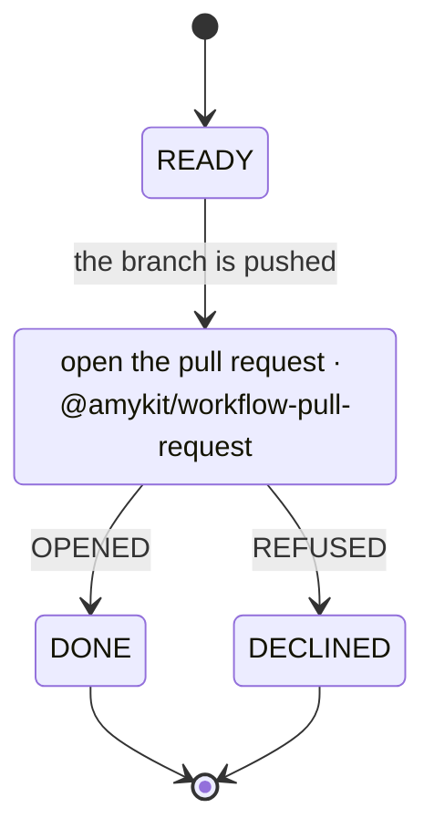
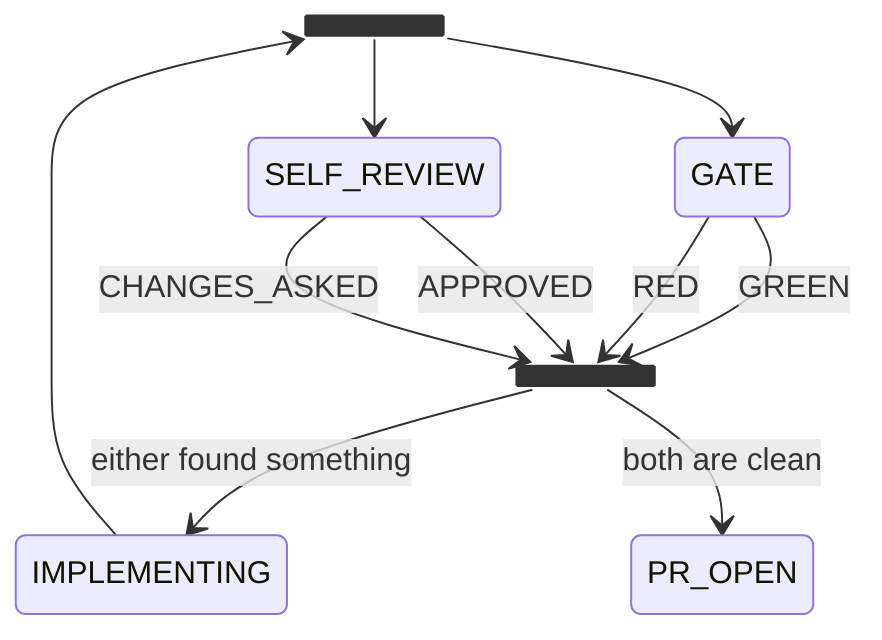

# Compose workflows

A [workflow](../concepts/glossary.md#workflow) composes the way a function
does. A small one takes an input, does its work and returns at one of its ends.
A bigger one calls it from the [state](../concepts/glossary.md#state) where that
work belongs. The shipped `note-to-plan` and errand workflows both open their
pull request this way, by calling
[`@amykit/workflow-pull-request`](../../examples/workflow-pull-request/README.md).
Why: [a workflow calls another](../design/a-workflow-calls-another.md).

## Draw the call

In the caller's [diagram](../concepts/glossary.md#diagram), a call is an
ordinary state marked `class … call`. Each edge out of it is named for one of
the callee's terminal states, so every way the callee can end has somewhere to
go. The label after `as` is for whoever reads the file:



## Bind it

`calls` binds each call state to the workflow it calls. A call state has no
`decide` key: the callee decides, and the end it reaches picks the edge.

```ts
import { advance, call, defineWorkflow, settled, type WorkRecord } from "@amykit/core";
import { plugin as pullRequest } from "@amykit/workflow-pull-request";

interface Ship extends WorkRecord { repo: string; branch: string; pullRequest?: number; refusal?: string }

export const plugin = defineWorkflow({
  name: "ship",
  configSchema: {},
  policy: {},
  needs: {},
  codeHostWrites: ["open-pull-request"],
  record: (workId) => ({ repo: "acme/shop", branch: workId }),
  calls: {
    PR_OPEN: call(pullRequest, {
      input: (work: Ship) => ({ repo: work.repo, branch: work.branch, title: `Ship ${work.branch}` }),
      config: { draft: true },
      output: {
        OPENED: (work: Ship, out) => ({ ...work, pullRequest: out.number }),
        REFUSED: (work: Ship, out) => ({ ...work, refusal: out.reason }),
      },
    }),
  },
  decide: {
    READY: () => advance("PR_OPEN", "the branch is pushed"),
    DONE: () => settled("the pull request is open"),
    DECLINED: () => settled("the code host would not open it"),
  },
  observe: async () => ({}),
  actions: {},
});
```

Every member of the binding is optional; `call(pullRequest)` is a whole call
for a callee that takes nothing.

- `input` maps the caller's [record](../concepts/glossary.md#record) to what the
  callee declares as its `input`. It is required when the callee declares one,
  and refused when it declares none.
- `config` is the callee's settings at this call site, checked against its
  schema at boot. Two call sites can configure the same callee differently.
- `ports` binds each of the callee's `needs` to a [port](../concepts/glossary.md#port)
  the root mounted, by name; left out, the port of the same name. Every
  dependency of the tree is configured once, at the root.
- `output` folds what the callee returned at an end into the caller's record.
- `effects` lists [actions](../concepts/glossary.md#action) the caller runs on
  the edge out, such as announcing why the pull request was refused.

The callee runs as a child record with its own history. While it runs, only the
deepest record is looked at, and a callee that needs the person shows that at
the root. The mount refuses, naming the call path: an end with no edge, an
`output` for an end the callee does not have, a need nothing mounts, a write
the callee claims and the caller does not (hence `codeHostWrites` above), and a
cycle of calls.

To change a callee, copy it into a workflow of yours and call the copy:

```sh
amy workflow add @amykit/workflow-pull-request --into ship
```

## Run calls side by side

A `<<fork>>` splits a path into lanes and a `<<join>>` waits for all of them.
Every lane is a call, each its own child record, and the number of lanes is the
number of lines drawn:



The fork has no `decide` key; the join does. It reads where each lane ended in
`record.lanes`, keyed by the lane's state, with each lane's output already
folded in:

```ts
import { advance, type Plan, type WorkRecord } from "@amykit/core";

export function verdict(record: WorkRecord): Plan {
  const clean = record.lanes?.GATE?.end === "GREEN" && record.lanes?.SELF_REVIEW?.end === "APPROVED";
  return clean
    ? advance("PR_OPEN", "the gate is green and the review found nothing")
    : advance("IMPLEMENTING", "a check found something; both findings go back together");
}
```

A lane bound with `revision` is lent a read-only tree at the caller's commit.
Lanes that write the same branch wait on a lease, and the wait costs no
attempt. The serial [engine](../concepts/glossary.md#engine) moves lanes in
turn; a concurrent one moves them at once and reaches the same record. Why:
[a workflow runs on lanes](../design/a-workflow-runs-on-lanes.md).
`ticket-to-qa` runs its gate and self-review this way.

## Mount several workflows

A [profile](../concepts/glossary.md#profile) is a name in `~/.amy/config.yaml`
that drives one root workflow. A machine holds as many as you list:

```yaml
workflows:
  tickets:
    workflow: "@amykit/workflow-ticket-to-qa"
  oncall:
    workflow: oncall               # a directory under ~/.amy/workflows
defaultWorkflow: tickets
```

Each profile keeps its records and queue under `~/.amy/<profile>/` and runs its
own loop: `amy --workflow oncall start`. All profiles share the event log, the
budget and the handbrake, so `amy stop --all` stops every loop. A profile mounts
the [plugins](../concepts/glossary.md#plugin) its root and every callee need; the callees are not listed.

A [project](../concepts/glossary.md#project) is a composition amy draws for
you. Name one of its `brief/`, `workflow/` or `prove/` folders as a profile's
workflow, and amy walks its phases as calls of one workflow in that one
profile. See [What a project is](what-a-project-is.md) and
[a project is brief, work and proof](../design/a-project-is-brief-work-and-proof.md).

## Next

- [Write a workflow](write-a-workflow.md): the callee you call is written the same way.
- [Configuration](../reference/configuration.md): every profile setting.
