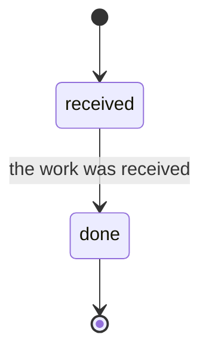
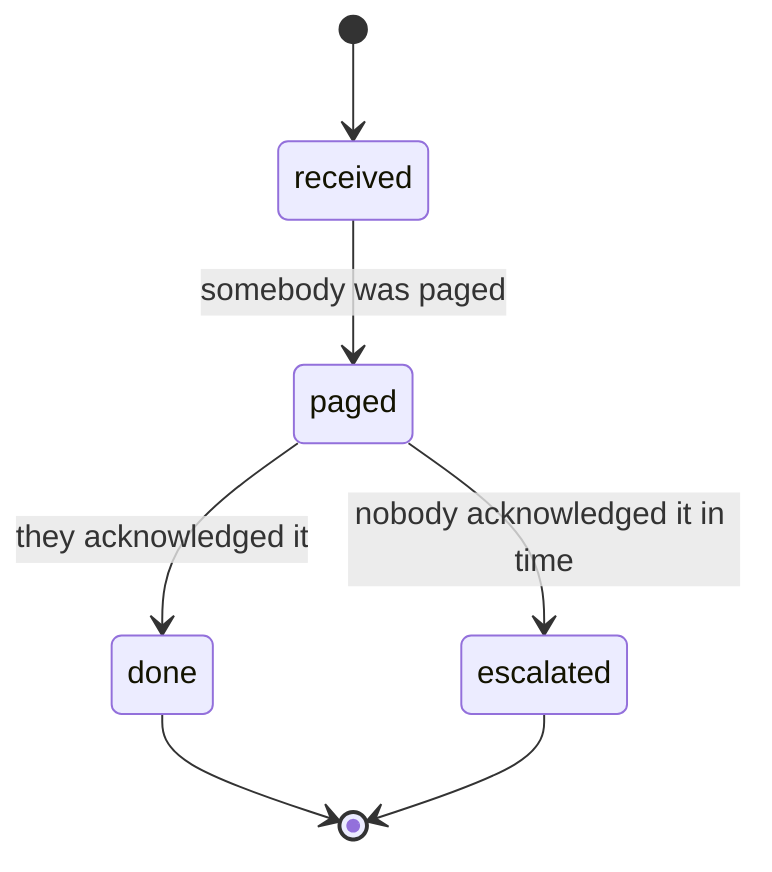

# Write a workflow

A [workflow](../concepts/glossary.md#workflow) is your process, kept in a
directory of yours. It is a package only if you decide to share it
([a workflow is yours, not a package](../design/a-workflow-is-yours-not-a-package.md)).
This page builds an on-call page from the files below. You can type them by
hand into `~/.amy/workflows/oncall/`, or let the shortcut write the same files:

```sh
amy workflow new oncall      # writes ~/.amy/workflows/oncall and a profile naming it
amy workflow check oncall    # drives it against a stub world before it drives real work
```

Without the shortcut, the [profile](../concepts/glossary.md#profile) is these
lines in `~/.amy/config.yaml`:

```yaml
workflows:
  oncall:
    workflow: oncall      # the directory under ~/.amy/workflows; a package name once published
```

The workflow is a [diagram](../concepts/glossary.md#diagram), a `decide` map and
an `actions` map, joined by one `defineWorkflow` call
([a workflow is one declaration](../design/a-workflow-is-one-declaration.md)).
This is what the shortcut writes:

<!-- amy:scaffold workflow.mmd -->


<!-- amy:scaffold decide.ts -->
```ts
// One decision per state workflow.mmd draws: where this piece of work goes
// next, given what the world says. Pure: nothing here awaits anything.
import { act, advance, settled, type Plan, type WorkRecord } from "@amykit/core";

export const decide: Record<string, (record: WorkRecord) => Plan> = {
  received: () => advance("done", "the work was received"),
  done: () => settled("the workflow is complete"),
};
```

<!-- amy:scaffold actions.ts -->
```ts
// What happens in the world. Every action a decision may emit, keyed by
// name: a handler given (scope, work, effect), whose `scope.ports` are the
// ports index.ts `needs`, bound to this piece of work, and whose
// `scope.announce` says a word to the operator; or { port, method } for a
// mounted port the host calls.
import type { WorkRecord } from "@amykit/core";

export const actions = {};

// What the actions produced, folded into the record. `record` has already
// moved: read where it came from in `moved.from`, never in `record.state`.
export function remember(record: WorkRecord): WorkRecord { return record; }
```

<!-- amy:scaffold index.ts -->
```ts
// This workflow belongs to this machine. Edit workflow.mmd, decide.ts and
// actions.ts; this file only joins them. `amy workflow check oncall` drives
// it before it drives real work, and `npm test` runs the machine's own suite
// over it. Node runs it as it is; `npm run build` compiles it for publishing.
import { defineWorkflow, type ConfigSchema } from "@amykit/core";
import { actions, remember } from "./actions.ts";
import { decide } from "./decide.ts";

export const plugin = defineWorkflow({
  name: "oncall",
  configSchema: {} satisfies ConfigSchema,
  policy: {},
  // The ports the actions use, each `port<T>()` or `optional<T>()`.
  needs: {},
  record: () => ({}),
  decide,
  discover: async () => ["example"],
  observe: async () => ({}),
  actions,
  remember: (_scope, record) => remember(record),
});
```

It runs as written: `amy workflow check oncall` walks one piece of work from
`received` to `done`. Node strips the types and runs the directory as it is;
`npm run build` compiles it into `dist/` for publishing.

## The diagram: where work can go

`workflow.mmd` is the only place the [states](../concepts/glossary.md#state)
are written. The `[*] -->` arrow marks the initial one, an arrow into `[*]`
marks a terminal one, and `class … waiting` marks a state where nothing happens
until somebody else moves. Name a state for where the work has got to.

<!-- amy:file workflow.mmd -->


`escalated` is a finished piece of work: giving up is an end you can see in the
log, kept apart from landing. `anywhere` lets any state that is not terminal
move to `done`, which the `before` hook below uses.

## decide: where it goes next

One function per drawn state. Each gets the [record](../concepts/glossary.md#record),
what `observe` saw and the policy, and returns a plan: `advance` to a drawn
state, `act` to run [actions](../concepts/glossary.md#action) and stay, `wait`
to look again later, or `settled`.
A decision awaits nothing and reads no file or clock, so the walkthrough can
replay it with no I/O. Every number lives in the policy, and `index.ts`
declares each one in `configSchema` so a profile can change it.

<!-- amy:file decide.ts -->
```ts
import { advance, settled, wait, type Plan, type WorkRecord } from "@amykit/core";

/** Everything from outside, gathered by `observe` before any decision. */
export interface Seen { acknowledged: boolean; resolved: boolean; now: Date }

export const policy = { ackWithinMs: 15 * 60_000, lookEveryMs: 60_000 };
type Decision = (record: WorkRecord, seen: Seen, chosen: typeof policy) => Plan;

export const decide = {
  received: () => advance("paged", "somebody was paged", { type: "page" }),
  paged: (record, seen, chosen) => {
    if (seen.acknowledged) return advance("done", "they acknowledged it");
    const pagedAt = Date.parse(record.history.at(-1)?.at ?? record.updatedAt);
    return seen.now.getTime() - pagedAt > chosen.ackWithinMs
      ? advance("escalated", "nobody acknowledged it in time", { type: "escalate" })
      : wait(chosen.lookEveryMs, "the page is not acknowledged yet");
  },
  done: () => settled("the page was answered"),
  escalated: () => settled("the page went to the secondary"),
} satisfies Record<string, Decision>;

/** Asked before any decision: an incident that resolved itself closes wherever it is. */
export function before(record: WorkRecord, seen: Seen): Plan | undefined {
  return seen.resolved && record.state !== "done" ? advance("done", "the incident resolved itself") : undefined;
}

/** Handed every decision: each move is said in the channel. */
export function after(decision: Plan): Plan {
  return decision.kind === "advance"
    ? { ...decision, effects: [...decision.effects, { type: "announce", text: decision.why }] }
    : decision;
}
```

`before` and `after` are optional. `before` returns a plan that replaces the
state's decision, or `undefined` to let it run. `after` sees every plan,
`before`'s included, and may change it. Write each `why` as a sentence a person
reads in the log.

## actions: what happens in the world

Every effect a plan carries names an action, and `actions` is the map from that name to what runs it. A handler gets the
scope (the [ports](../concepts/glossary.md#port) `needs` asked for, bound to this
piece of work, plus `announce`), the work, and the effect. A value may instead
be `{ port, method }` for a mounted port that answers the action itself; see
[Actions](../concepts/actions.md).

<!-- amy:file actions.ts -->
```ts
import type { Action, ActionContext, WorkRecord } from "@amykit/core";

/** The port this workflow pages through, mounted by a plugin. */
export interface Pager {
  open(): Promise<string[]>;
  page(id: string, who: "primary" | "secondary"): Promise<void>;
  acknowledged(id: string): Promise<boolean>;
  resolved(id: string): Promise<boolean>;
}

interface Scope { readonly ports: { readonly pager: Pager }; announce(text: string): Promise<void> }

export const actions = {
  page: async ({ ports }: Scope, { record }: ActionContext) => ports.pager.page(record.id, "primary"),
  escalate: async ({ ports }: Scope, { record }: ActionContext) => ports.pager.page(record.id, "secondary"),
  // A failed channel becomes a `notify.failed` line; it never costs the work a move.
  announce: async ({ announce }: Scope, _work: ActionContext, effect: Action) => announce(String(effect.text)),
};

export function remember(record: WorkRecord): WorkRecord { return record; }
```

`remember` folds what the handlers wrote into `outcomes` back into the record.
It never folds the state, the attempts or the history: the [engine](../concepts/glossary.md#engine) already did,
and a second fold counts every retry twice. The record it gets has already
moved, so where it came from is `moved.from`.

Then `index.ts` declares the policy, asks for the port and passes the new pieces:

<!-- amy:file index.ts -->
```ts
import { defineWorkflow, port, type ConfigSchema } from "@amykit/core";
import { actions, remember, type Pager } from "./actions.ts";
import { after, before, decide, policy, type Seen } from "./decide.ts";

export const plugin = defineWorkflow({
  name: "oncall",
  // Each policy number, so a profile's `settings.policy` can change it.
  configSchema: {
    "policy.ackWithinMs": { type: "number", default: 900_000, description: "how long a page waits before it escalates" },
    "policy.lookEveryMs": { type: "number", default: 60_000, description: "how often a waiting page is looked at" },
  } satisfies ConfigSchema,
  policy,
  needs: { pager: port<Pager>() },
  record: () => ({}),
  before,
  decide,
  after,
  discover: async ({ ports }) => ports.pager.open(),
  observe: async ({ ports, ctx }, record): Promise<Seen> => ({
    acknowledged: await ports.pager.acknowledged(record.id),
    resolved: await ports.pager.resolved(record.id),
    now: ctx.now(),
  }),
  actions,
  remember: (_scope, record) => remember(record),
});
```

Something must mount the `pager` port: a [plugin](../concepts/glossary.md#plugin)
of yours ([Write a plugin](write-a-plugin.md)) or one you install, listed under
the profile's `plugins`.

## The walkthrough test

`amy workflow check oncall` is what to run while editing. It drives the
workflow against a stub world and refuses a waiting state that moved before the
world did, an action with nothing behind it, a state the walk never reaches, and
a run that does not settle in a terminal state.

The shortcut also writes `index.test.ts`, which `npm test` runs. It mounts the
workflow the way amy does and hands its runtime to `conforms`, with the worlds
to walk:

```ts
import { describe, it } from "node:test";
import { withDiagramBeside, type WorkflowRuntime } from "@amykit/core";
import { conforms } from "@amykit/workflow-testkit";
import { plugin } from "./index.ts";

declare const runtime: WorkflowRuntime; // what index.test.ts mounted
const drawn = withDiagramBeside(plugin, import.meta.url);
let acknowledged = false; // what the stand-in pager answers

conforms(drawn.workflow, {
  runner: { describe, it },
  runtime: () => runtime,
  worlds: [
    { name: "somebody acknowledges", meanwhile: [() => { acknowledged = true; }] },
    { name: "nobody acknowledges" },
  ],
});
```

`conforms` walks the workflow through each world. It fails a state nothing reaches or leaves, an action with no
handler, a wait that spends the ceiling for giving up, a decision made by an
empty `every`, and a giving-up state with no honest way out
([a testkit proves the machine](../design/a-testkit-proves-the-machine.md)).
A world's `meanwhile` runs only while the machine waits, so a state that moves
without one moved on something already there. Once `needs` asks for `pager`,
mount a stand-in plugin for it beside `drawn`, and add a world per path. See
[Testing](../build/testing.md#the-conformance-suite).

The `.software-factory/` the shortcut writes is the static half: `sf check` in
the directory refuses `checkout -B`, a fold reading `.state` off a moved record,
and an `.every(` that does not say what an empty collection means
([the guardrails ship with the workflow](../design/the-guardrails-ship-with-the-workflow.md)).

## Mistakes the host cannot catch

The host refuses at boot a decision missing for a drawn state, an action with
no handler or port, and a port nothing mounts; `amy workflow check` refuses a
run that spins. These it cannot see:

| Mistake | What it costs |
| :-- | :-- |
| I/O or the clock read inside a decision | The walkthrough needs a world it cannot replay, so the lifecycle goes unproven |
| Folding state or attempts in `remember` | Every retry counts twice; ceilings fire at half their value |
| No terminal state for "no" | Giving up looks like landing |
| A ceiling checked after the agent call | A report where a brake was meant |
| A `why` written for a machine | A log nobody can read at 3am |

## When to split it into more files

Split when a file stops fitting on a screen. Move the record and observation
types into `types.ts` once both halves import them, give each large decision
its own file under `decide/`, and keep each port's handlers beside the port's
interface. `index.ts` stays the one place that joins them. `workflow.mmd`
stays one file.

## Next

- [Compose workflows](compose-workflows.md): call another workflow from a state.
- [Workflows](../concepts/workflows.md): the contract in detail.
- [Publishing](../build/publishing.md): share it as a package.
