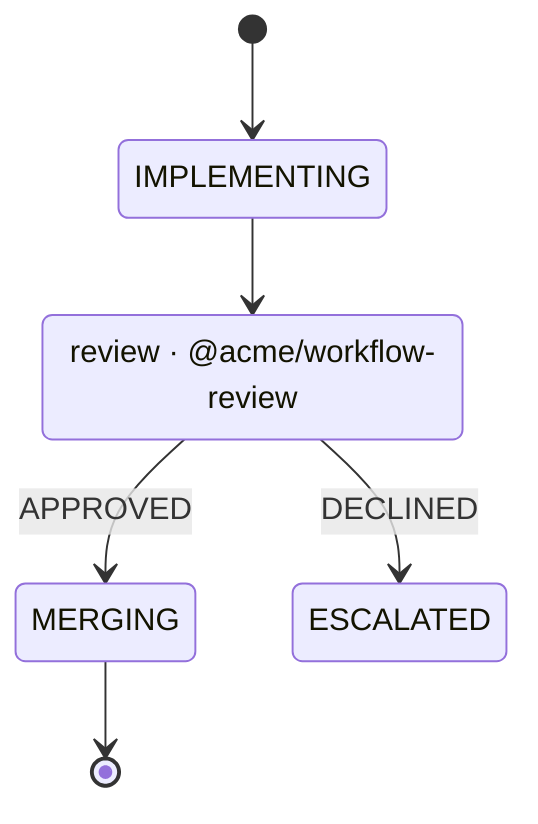

# A workflow calls another

A workflow should compose the way code does. A small workflow is a function: it
takes input and configuration, does its work, and returns at one of its ends
with an output. A bigger workflow calls it at the point where that work
belongs, the same way a function calls a library, and the callee can call
others in turn, as deep as the work needs. Installing somebody else's workflow
then means using it inside your own, instead of adopting their whole process.

Today composition happens in TypeScript, out of sight.
[A private workflow composes the shipped one](../docs/design/a-private-workflow-composes-the-shipped-one.md)
made it possible for a private workflow to import `ticket-to-qa`'s `plan` and
runtime, and that private workflow shrank to its policy, prompts and gate
commands. But nothing in either diagram shows where one workflow ends and the
other begins. Nothing checks the seam either: the importer reaches into the
other workflow's states and record fields as if they were its own.

The repetition is already in this repository. All three shipped workflows open
a pull request and wait on it:

- `note-to-plan` and the errand both go `PR_OPEN → DONE`;
- `ticket-to-qa` runs its whole review loop from `PR_OPEN` to `MERGING`.

That is one small workflow written three times.

## What changes

**A state can be a call.** In the diagram it is an ordinary state, marked with
the class `call`. Its label may name what it calls, for whoever reads the file
on GitHub or in Obsidian:



The edges out of a call state are named for the callee's terminal states. They
are the return values the caller handles. Mermaid has no `import` or `include`,
and its state syntax needs none for this: the label is prose, the class is
what amy reads, and the binding to a package is in code. The subset that
[a workflow is a Mermaid diagram](a-workflow-is-a-mermaid-diagram.md) reads
gains `call` beside `waiting`, `attention`, `anywhere` and `returns`.

**A workflow declares its signature.** `defineWorkflow`
([a workflow is three pieces](a-workflow-is-three-pieces.md)) gains three
optional members:

- `input`: what a caller must pass, as a schema, the way `configSchema` types a
  plugin's settings ([a config is typed by its schema](../docs/design/a-config-is-typed-by-its-schema.md)).
  The record starts with it, and `decide` reads it typed.
- `output`: what it returns, keyed by terminal state. `APPROVED` may return
  `{ mergedAt }`, and `DECLINED` `{ reason }`. A workflow with no `output`
  returns nothing at any end.
- `configSchema`: the callee's own settings. They are set per call site, so the
  same review workflow can allow three rounds in one caller and one round in
  another.

**A caller binds the call in one place.** Beside `decide` and `actions`:

```ts
calls: {
  REVIEW: call(review, {
    input: (work) => ({ repo: work.repo, pullRequest: work.pullRequest }),
    config: { maxRounds: 3 },
    ports: { agent: "agent-strong" },
    output: {
      APPROVED: (work, out) => ({ ...work, mergedAt: out.mergedAt }),
      DECLINED: (work, out) => ({ ...work, declinedFor: out.reason }),
    },
  }),
},
```

- `input` maps the caller's record to the callee's input, typed both ways.
- `config` is the callee's settings for this call, validated against its schema
  at boot.
- `ports` binds each of the callee's `needs` to a port the root has mounted,
  by name, defaulting to the port with the same name. Every dependency of the
  whole tree is therefore configured once, at the root, in `config.yaml`. A
  need nothing satisfies is refused at boot with the full call path, for example
  `oncall → REVIEW → FIX: needs code-host`.
- `output` folds each return value into the caller's record. It needs one entry
  per terminal state of the callee: a missing one, or one for a state the
  callee does not have, is refused by name.

A call state needs a `calls` entry and no `decide` key. The call is its
decision.

**Calls nest without limit, and never in a circle.** A callee may call others.
At mount, amy builds the graph of calls from every workflow in the tree and
refuses a cycle, naming it: `review → fix → review`. Depth has no limit. A
cycle is the only thing that cannot terminate by construction, so it is the
only thing refused.

**A call is a child record, and it costs nothing while it runs.**

- **Entering the state.** Entering a call state creates the callee's record
  under the caller's id: `TBO-1/REVIEW`, and below it `TBO-1/REVIEW/FIX`. The
  child starts at its initial state with its input.
- **Only the deepest active record is looked at.** A caller in a call state
  waits, but it waits on an event, not a timer. The engine looks at it again
  only when its child reaches an end. So a tree five calls deep is not five
  records polling: it is one record working and four that cost nothing.
- **Returning.** When the child reaches a terminal state, the engine computes
  its output and folds it into the caller with that call's `output` function.
  The caller then takes the edge named for that terminal state.
- **Each record keeps its own history.** Each child has its own `attempts`,
  `looks`, evidence and kept runs, so nothing a callee counts can push a caller
  over its ceiling.

**What a callee does is bounded by its caller.** A callee's write claims must
fit inside its caller's claims, so installing a workflow cannot hand it a
tracker or code-host write the person never granted. A callee whose claims
exceed its caller's is refused at boot, naming the write. A child that escalates
also makes its root show attention in the menu bar and the window. The child's
evidence appears with the root (*an escalation brings its evidence*), so the
person sees where in the tree it stopped.

**A callee is a package, or a copy you own.** A call names its callee the way
code names a module: a package specifier or a path.

- `amy add @acme/workflow-review` installs it as a dependency, pinned like any
  plugin, and updated through the normal update path.
- `amy workflow add @acme/workflow-review --into oncall` copies its diagram and
  its file into `~/.amy/workflows/oncall/workflows/review/` instead. That is how
  shadcn/ui hands out components: the source becomes yours to read and change,
  and nothing updates it behind you. The copy is still a workflow, and it is
  called the same way.

Either way, the binding names it once, and the call graph is checked the same
way.

**The tree is drawn from the files.** `amy show` and the window draw a caller
with the record's path through its callees. `amy workflow export --expand`
inlines each callee as a Mermaid composite state, `state REVIEW { … }`. That is
valid Mermaid and renders on GitHub, and it is generated for reading only. The
source subset keeps refusing composite states, because a source file holds one
workflow and a call holds the rest.

## The first callee

`@amykit/workflow-pull-request` is the workflow all three shipped ones repeat.
It takes a repository, a branch and a body as input, opens the pull request,
waits on its review, and returns `MERGED` with its number or `CLOSED` with the
reason. `note-to-plan` and the errand call it in place of their own `PR_OPEN`.
`ticket-to-qa` calls it where its review loop starts, if that loop fits the
callee once `ticket-to-qa`'s reviewer roster becomes the callee's input. If it
does not fit, the plan says which part stayed in `ticket-to-qa`, and why.

## Acceptance criteria

- [ ] A call state with no `calls` entry, a call whose `output` misses one of
      the callee's terminal states or names one it does not have, and a callee
      need no mounted port satisfies are each refused at boot, by name and
      call path
      (proof: deferred:test:packages/core/tests/calls.test.ts)
- [ ] A cycle of calls at any depth is refused at mount, naming every workflow
      on it (proof: deferred:test:packages/core/tests/calls.test.ts)
- [ ] A call three deep runs to the end: the caller's record waits without
      being looked at, takes the edge named for the callee's terminal state,
      and holds the output the callee returned
      (proof: deferred:test:packages/workflow-testkit/tests/calls.test.ts)
- [ ] The same callee called from two sites with two configs behaves
      according to each config
      (proof: deferred:test:packages/workflow-testkit/tests/calls.test.ts)
- [ ] A callee whose write claims exceed its caller's is refused at boot,
      naming the write (proof: deferred:test:packages/core/tests/calls.test.ts)
- [ ] A callee that escalates shows attention at its root, and its evidence is
      shown with the root (proof: deferred:assertion:plan.a_callee_escalates_to_its_root)
- [ ] `amy workflow add --into` copies a callee into the caller's directory,
      and the copy is called and drawn like the package
      (proof: deferred:assertion:mine.a_copied_callee_is_called)
- [ ] `amy workflow export --expand` prints a composite diagram Pele parses
      (proof: deferred:test:packages/cli/tests/workflow-export.test.ts)
- [ ] `note-to-plan` and the errand call `@amykit/workflow-pull-request`
      instead of their own `PR_OPEN`, and their scenarios are unchanged
      (proof: assertion:plan.a_refused_draft_goes_back_to_the_agent)

**Exit condition:** `note-to-plan` and the errand open and follow their pull
requests by calling one shipped workflow, configured per caller and bound to
ports in one `config.yaml`. A workflow three calls deep runs to its end with
only the deepest record ever looked at. A cycle is refused at mount. A callee
copied into somebody's own workflow directory is called the same way as the
package it came from.
