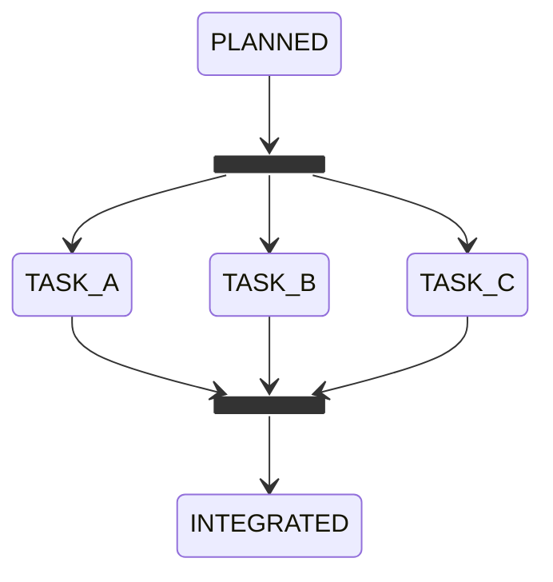

# A workflow runs on lanes

amy is synchronous, and that is worth keeping. One move per look, one look per
item, and a record is always in one state you can point at. Reading what the
machine is doing is reading a diagram with a mark on it.

But a lot of work is a factory line, not a single file. Some pieces can run
side by side and meet again after: three tasks of one feature on three
branches, three reviewers of one change, three repositories of one ticket.
Today that is one record at a time, serially, or it is written by hand in a
workflow's runtime, out of the diagram's sight.

`docs/concepts/the-engine.md` already says a concurrent engine is a plugin, as
long as it keeps the atomic claim, one move per look, and the budget check
before the call. What is missing is where a workflow says what may run in
parallel. A setting would be one more place to keep in step with the diagram.
The diagram is where it belongs.

## What changes

**A lane is a line in the diagram.** Mermaid already has the syntax:
`<<fork>>` splits one path into several, and `<<join>>` waits for all of them.
The subset (*a workflow is a Mermaid diagram*) stops refusing the two, and
gives them one meaning. Every branch of a fork is a lane, and the number of
lanes is the number of lines drawn:

There is no `lanes:` setting. To run four lanes, draw four. What a reader sees
on GitHub is what the machine runs.

**A record stays in one state. Every lane is a call.** The reader refused fork
and join because "a record is in one state at a time" (`packages/core/src/diagram.ts`).
That stays true. Every branch of a fork must be a call state
(*a workflow calls another*), and each lane is its own child record, with its
own state, history and attempts:

- **At the fork,** the caller's record waits in the fork, and every branch
  starts its callee at once.
- **Input per lane.** Each lane takes its input from its own call binding:
  `TASK_A` gets the first task, `TASK_B` the second.
- **At the join,** the caller moves on only when every lane has ended. It
  takes the join's edge with every lane's output folded in, keyed by the lane's
  state.
- **When a lane escalates,** its siblings carry on, and the caller waits in the
  join. The join reports which lanes are done and which one needs the person.

Within a lane, everything is as synchronous as today. Parallelism is only
between records that are already separate.

**Lanes hold what they use, and the host decides who waits.** Three lanes can
contend for the same things:

- **A checkout.** The private workflow's `waitForTheTree` exists because two
  pieces of work shared one tree. A lane's checkout comes from
  `ctx.checkouts()` (*the host lends the checkout*), one worktree per lane
  ([the worktree is the workplace](../docs/design/the-worktree-is-the-workplace.md)).
  Two lanes on the same branch are refused at boot, because they would write
  the same tree.
- **An agent.** Every lane's run passes the same budget check before the call,
  and a usage limit refunds the attempt (*waiting is not trying*). Three lanes
  hitting the limit wait, they do not fail.
- **A pull request.** Lanes that open pull requests on one repository open
  separate ones. Integrating them is the state after the join, drawn as such.

None of these is declared by the workflow. They follow from the ports a lane
uses, and the host serialises what two lanes would otherwise share.

**The engine claims more than one item at once, and nothing else changes.**
The serial engine stays the default and runs lanes one move at a time, in turn.
That is correct, only slower. A concurrent engine runs one move per lane at a
time, up to the number of lanes the mounted diagrams draw. It keeps the file
queue's atomic claim, one move per look, and the budget check before the call.
It is a plugin, as `docs/concepts/the-engine.md` says it should be.

**The window draws lanes as lines.** The fork's lanes are drawn side by side,
each with its record's mark. A join shows how many lanes have arrived. That is
the factory floor: you see where the line backs up.

## Acceptance criteria

- [ ] A diagram whose fork branches are all call states mounts, one whose
      branch is not a call is refused naming it, and a join with a branch that
      never reaches it is refused
      (proof: deferred:test:packages/core/tests/diagram.test.ts)
- [ ] A fork of three lanes starts three callee records at once, each with its
      own input, and the caller leaves the join only when all three have
      ended, with every output keyed by lane
      (proof: deferred:test:packages/workflow-testkit/tests/lanes.test.ts)
- [ ] A lane that escalates leaves its siblings running, and the caller waits
      in the join saying which lane needs the person
      (proof: deferred:test:packages/workflow-testkit/tests/lanes.test.ts)
- [ ] Two lanes never share a worktree, and two lanes on one branch are refused
      at boot (proof: deferred:test:packages/core/tests/lanes.test.ts)
- [ ] Under the serial engine, three lanes reach the same end state, in turn,
      as under the concurrent one
      (proof: deferred:assertion:plan.lanes_end_the_same_serial_or_concurrent)

**Exit condition:** a workflow that draws a fork into three call states runs
three tasks of one feature at once, each in its own worktree. It joins when
all three have ended. It shows the person which lane escalated, while the
other two keep going. The number of lanes is the number of lines in its
`workflow.mmd`, and nothing else.
