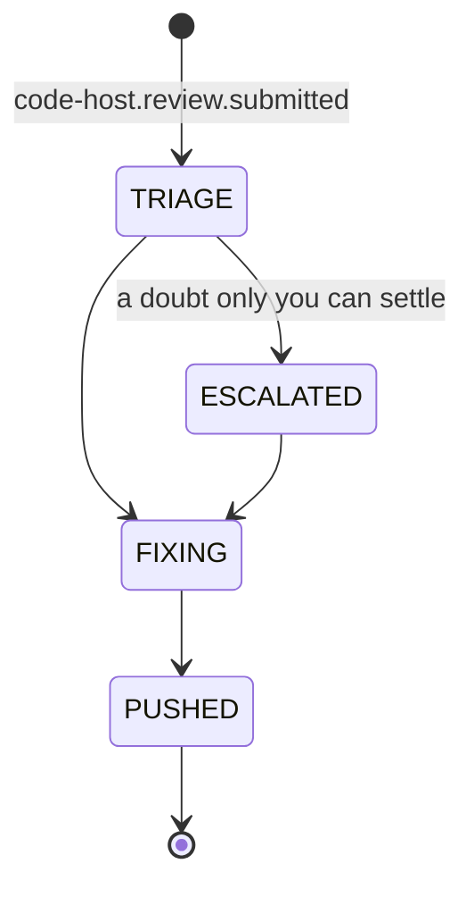

# A workflow starts on an event

A workflow today is one lifecycle for the whole life of a piece of work.
`ticket-to-qa` goes from the working status to QA in one diagram, and the
private workflow amy runs at work in twenty-one states. Most of its length is
waiting: for a reviewer, for an automated reviewer, for a fix to be
re-reviewed, for an answer. Each wait is a state that polls, and each round of
review loops back through the same states.

A shorter shape is a workflow that begins when something happens and ends
when it has dealt with it:

- a ticket reaches the working status → read it → work on it → open the pull
  request → `[*]`;
- a review is submitted → judge what holds and what does not → escalate on a
  doubt → fix → push → `[*]`.

Each one has a beginning, a middle and an end that fits on a screen. The
review loop is no longer a loop in one diagram. It is the second workflow,
started again by each review.

## What changes

**The edge out of `[*]` may name the event that starts the workflow.** The
label is read on the edge out of `[*]` the same way as on a waiting state's
edge (*an event is a reason to look*):

Each such event starts one record of this workflow. A workflow whose `[*]` edge
names no event is discovered as today. A workflow may be started by events and
discovered as well, and polling stays the net under both
(*an event is a reason to look*).

**Every run carries a correlation key, and the runs of one key are one
lineage.** The two workflows above share a context that a fresh start would
lose:

- the ticket and its brief;
- what earlier rounds of review settled
  ([the review is remembered across rounds](the-review-is-remembered-across-rounds.md));
- how many attempts the work has spent.

So `defineWorkflow` (*a workflow is three pieces*) gains `key`, a function from
the event to what the work is about. It is usually the ticket, which the
code-host event finds through the pull request it names. Every run with the
same key is one lineage:

- **Ids.** A run's id is its key and its workflow: `TBO-1/review#3`.
- **Reading back.** `observe` can read the records of earlier runs in its
  lineage, read-only, through the store. The review workflow reads what the
  build workflow wrote and what the last review round settled.
- **One run per key at a time.** An event for a key whose run of this workflow
  is still going does not start a second one. It wakes the one that is going.
  Two reviews in a minute are one round, not two racing runs.

**`amy show` tells the lineage as one story.** `amy show TBO-1` lists every run
of every workflow with that key, in order, each with its history and evidence
(*an escalation brings its evidence*). The window draws the same, so splitting
one long workflow into short ones costs the person no view.

**What is not split.** A wait in the middle of a piece of work stays a state
that an event wakes: `CLARIFYING` waiting on a reply is still part of the run
that asked. A workflow starts on an event only when what follows is a new
piece of work: a new review round, a new ticket. Both shapes stay valid, and
the docs say which to reach for.

## Acceptance criteria

- [ ] An event named on a workflow's `[*]` edge starts one record of it, keyed
      by the workflow's `key`, and a second event for the same key while that
      run is going wakes it instead of starting another
      (proof: deferred:test:packages/workflow-testkit/tests/triggers.test.ts)
- [ ] A run reads the records of earlier runs in its lineage, read-only, and a
      write to one is refused (proof: deferred:test:packages/core/tests/lineage.test.ts)
- [ ] `amy show <key>` lists every run of every workflow with that key, in
      order, with each one's history and evidence
      (proof: deferred:test:packages/cli/tests/show.test.ts)
- [ ] A workflow whose `[*]` edge names no event is discovered exactly as before
      (proof: assertion:plan.a_refused_draft_goes_back_to_the_agent)

**Exit condition:** a ticket's work is two shipped-style workflows instead of
one loop. One builds the change and opens the pull request. The other starts
on each review, settles it and pushes. Two reviews in a minute make one round,
and `amy show` tells the whole ticket as one story across both.
