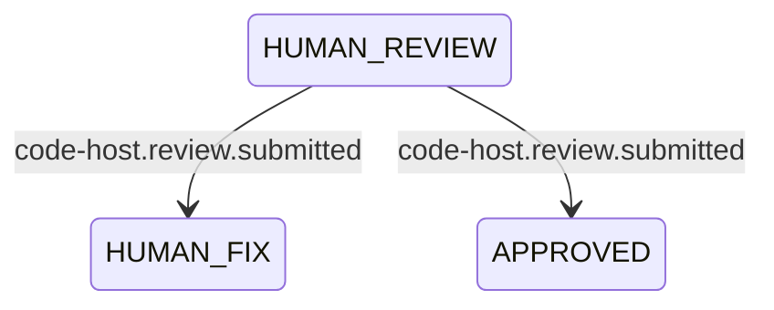

# An event is a reason to look

amy learns that something happened by asking. The daemon discovers on a
cadence, and a waiting state looks again when its backoff runs out. One ticket
escalated, then looked 25 times in two hours, every five minutes, to read
"waiting for you" again. The private workflow's `COPILOT_WAIT`, `HUMAN_REVIEW`
and `ESCALATED` are all polling for something that happens once: a review
arrives, a reply is posted. The cost is twofold. A person answers and waits up
to a backoff for amy to notice. And every look spends an observation against
the tracker and the code host for nothing.

The tools already say when something happens. GitHub sends `pull_request` and
`pull_request_review` webhooks, Linear sends an `Issue` webhook on create and
update, and Slack sends message events. amy hears none of them.

## What changes

**An event puts a look on the queue, and changes nothing else.** An event
source turns what a tool reports into an item on the existing queue, for the
work it concerns, with a priority set by the event's kind. The look that item
causes is an ordinary look:

- `observe` reads the world;
- the pure `plan()` decides;
- one move is made.

The event's payload is never the observation. Events arrive twice, out of
order, or late, and a record that trusted one would act on a world that has
already moved. amy stays synchronous: one move per look, one look per item,
the same claim and the same record. Events change only when a look happens.

**Events are named for the port, not the vendor.** The core names them by the
port that reports them, so a workflow reads the same name whichever tool
sends it:

- `code-host.pull-request.opened`, `code-host.review.submitted` and
  `code-host.thread.replied`;
- `tracker.ticket.created`, `tracker.ticket.updated` and
  `tracker.comment.created`;
- `conversation.reply.posted`.

Each adapter translates its tool's payload into one of those names and the work
ids it concerns. The core's vocabulary stays neutral, which is what
`THE_CORE_NAMES_NO_VENDOR` already holds it to.

**A waiting state says what wakes it, in the diagram.** An edge out of a
waiting state may be labelled with an event name:

That event wakes a record in that state. It does not choose the edge: `plan()`
still decides which way to go. A label is still prose, with one exception
(*a workflow is a Mermaid diagram*): a label that names a published event is
read. A dotted name nothing publishes is refused at boot, so a typo cannot
silently stop a wait from ever waking. A waiting state with no event edge
keeps its backoff, as today. One with an event edge keeps a slow backoff as
well. That fallback is the reconciliation, not the way the state normally
wakes.

**Polling stays, as the net under the events.** Discovery keeps running, at a
longer cadence once a source reports events. It is what finds the work an event
never reached: the laptop was asleep, the daemon was stopped, the tunnel was
down. `amy doctor` says, per source, whether events are arriving or amy is
polling only.

**The plugins that exist are the sources.** No new plugin is needed to start:

- **`@amykit/plugin-github`** receives `pull_request`, `pull_request_review`
  and `pull_request_review_comment` webhooks. They arrive at the server's
  `POST /v1/events/github` (*the server speaks in domains*), verified by the
  webhook secret's `X-Hub-Signature-256`. A webhook needs a public HTTPS URL,
  so this reaches a laptop through a tunnel the person runs. GitHub's
  `gh webhook forward` is documented for testing only and allows one person per
  repository, so the docs offer it for trying events out, not for running amy.
- **`@amykit/plugin-linear`** receives `Issue` and `Comment` webhooks at
  `POST /v1/events/linear`, verified by `Linear-Signature`, an HMAC-SHA256 of
  the raw body. Linear requires a public HTTPS URL that is not localhost, and
  only a workspace admin can create the webhook.
- **`@amykit/plugin-slack`** keeps reading threads through the Web API. It
  avoids Socket Mode on purpose: Slack hands each event to one of an app's
  connections, so amy would take events from whatever else shares the app
  (`plugins/slack/src/SlackApi.ts`). Socket Mode becomes a setting, off by
  default, for an install whose Slack app is amy's alone.
- **Polling itself is a source.** It is what a plugin with no events does, and
  it is the reconciliation behind every plugin that has them.

**The shipped workflows prove it, end to end.** The `ticket-to-qa` scenario
gains a run with `amy serve` up on the loopback, which needs no tunnel. Its
stand-in `gh` moves a pull request, and the scenario posts the signed webhook
GitHub would have sent: a recorded `pull_request_review` payload with its
`X-Hub-Signature-256`. The record must move before its backoff could have run
out. The same run posts a Linear `Issue` webhook for a ticket created in the
working status, and the ticket must be picked up. It then posts one payload
with a bad signature, which must be refused and change nothing. The existing
runs, which have no events at all, stay as they are, and they are the proof
that polling still carries everything. The `ticket-to-qa` gate requires the
new assertions, and adds the event code in `plugins/github/src/**` and
`plugins/linear/src/**` to what it already watches.

**How to use it is a page, proven like the code.** *Receive events* lives under
`docs/build/` and covers, for each source:

- what to create on the tool's side, and which events to tick;
- the secret and where it goes in `config.yaml`;
- the tunnel and how to check it is up;
- what `amy doctor` prints when events arrive, and when they do not.

Every command on the page is run by the docs check against a recorded payload
from the tool's own documentation. Each payload is a fixture beside the
adapter's tests, so a signature or a field the adapter misreads fails the
build.

## Acceptance criteria

- [ ] An event becomes one queue item for the work it concerns, at its kind's
      priority, and the look it causes is an ordinary look that reads the
      world rather than the payload
      (proof: deferred:test:plugins/serial-engine/tests/Worker.test.ts)
- [ ] The same event delivered twice, or two out of order, makes no more moves
      than one look would
      (proof: deferred:test:plugins/serial-engine/tests/Worker.test.ts)
- [ ] A waiting state with an event edge wakes on that event without waiting
      for its backoff, and a dotted label nothing publishes is refused at boot
      (proof: deferred:test:packages/core/tests/diagram.test.ts)
- [ ] GitHub's and Linear's recorded webhook payloads are verified by their
      signatures, translated into port events with the right work ids, and a
      bad signature is refused
      (proof: deferred:test:plugins/github/tests/events.test.ts)
- [ ] With no events arriving, discovery and backoffs still find and move every
      piece of work, and `amy doctor` says the source is polling only
      (proof: deferred:assertion:mine.polling_is_the_net_under_events)
- [ ] In the `ticket-to-qa` scenario, a signed review webhook moves its record
      before the backoff runs out, a signed Linear webhook gets a new ticket
      picked up, and a badly signed payload is refused and moves nothing
      (proof: deferred:assertion:lifecycle.an_event_moves_its_record_before_the_backoff)
- [ ] *Receive events* sets up each source with only what the page says, and
      every command on it runs in the docs check
      (proof: deferred:test:scripts/docs/tests/examples.test.ts)

**Exit condition:** in the `ticket-to-qa` scenario, a signed review webhook
moves its record and a signed Linear webhook gets a ticket picked up, both
before any backoff, and the gate requires it. On a real install, a review
submitted on a pull request moves its record within seconds, through the
GitHub plugin and a tunnel, and a Linear ticket created in
the working status is picked up the same way. With the tunnel down, both still
happen at the polling cadence. A person sets up either from *Receive events*
alone.
